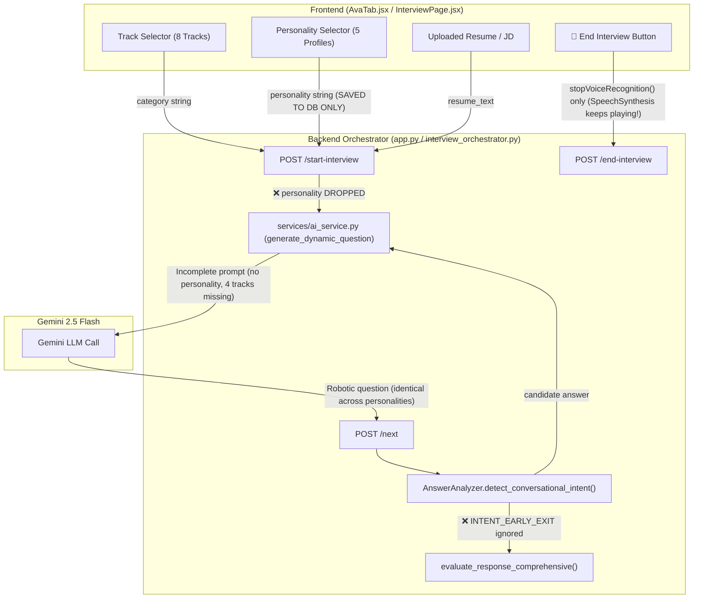

# AUDIT_AVA.md: Architectural Audit of PrepFly AI Interviewer ("Ava")

> **Date:** 2026-11-10  
> **Target:** Live Human-like AI Interviewer Engine (Ava)  
> **Scope:** Full-stack inspection of Frontend (`AvaTab.jsx`, `InterviewPage.jsx`, `speechEngine.js`, `aiInterviewerConfig.js`), Backend routes (`app.py`, `routes/interview.py`), orchestration services (`services/ai_service.py`, `services/interview_orchestrator.py`, `services/interviewer_personality_service.py`, `services/answer_analyzer.py`), and speech services.

---

## 1. Executive Summary & Root Cause Verifications

| Bug # | Observed Problem | Root Cause Confirmed with Code Reference | Severity |
|---|---|---|---|
| **1** | Questions do not stay inside selected track (e.g. MAANG, Guesstimate, Logic Puzzles). | `services/ai_service.py:230-277` only handles DSA, Systems, Fundamentals, and HR. Tracks like MAANG, Guesstimate, Logic Puzzles fall into generic `else: RESUME`, causing off-topic drift or fallback to DSA. | **Critical** |
| **2** | No natural opening or human rapport; jumps immediately into questioning. | `services/ai_service.py:207-215` hardcodes a single rigid 1-line Turn 1 greeting with zero multi-turn icebreaking, zero track/format briefing, and zero personality adaptation. | **High** |
| **3** | Ava replies in a robotic, fixed pattern; lacks active listening follow-ups. | `app.py:2481-2510` generates questions in isolation using a broad prompt; no conversational state machine (`ASKED`, `PROBING`, `CHALLENGING`, `HINTING`) to enforce active listening. | **High** |
| **4** | Selected Interviewer Personality does not change tone, depth, or behavior. | `app.py:2262-2272` and `services/ai_service.py:176-190` **completely omit `personality`** from the `generate_dynamic_question` signature and LLM prompt. Personality is stored in the DB but never passed to the prompt! | **Critical** |
| **5** | Saying "end the interview" / "let's stop" fails to end the interview. | `app.py:2372-2417` handles `INTENT_REPEAT` and `INTENT_CLARIFY`, but **never checks `INTENT_EARLY_EXIT`**! The utterance is treated as a technical answer, graded by the rubric, and advances to the next question. | **Critical** |
| **6** | Candidate silence does nothing; no proactive check-ins or pauses. | There is no Voice Activity Detection (VAD) or silence escalation timer in frontend (`AvaTab.jsx`) or backend (`app.py`). Silence causes indefinite hanging or triggers a static fallback answer. | **High** |
| **7** | Small talk (e.g., "how are you?") is graded as a technical answer. | `AnswerAnalyzer.detect_conversational_intent()` (`services/answer_analyzer.py:46-68`) lacks small talk detection, returning `INTENT_ANSWER`. It gets evaluated by `evaluate_response_comprehensive` and assigned a bogus score. | **High** |
| **AUDIO** | **Audio Cutoff Bug:** Ava keeps speaking after clicking "End Interview". | `AvaTab.jsx:1110` (`endInterviewSession`) calls `stopVoiceRecognition()` but **NEVER calls `window.speechSynthesis.cancel()`**, fails to abort in-flight `/text-to-speech` calls, and in-flight question promises continue playing audio. | **Critical** |

---

## 2. Frontend Inspection

### 2.1 Track Selection & Setup Screens
- **Track Screen:** `f_frontend/src/components/AvaTab.jsx:1206-1215` defines 8 tracks: `MAANG`, `DSA`, `Resume`, `Fundamentals`, `Guesstimate`, `Puzzles`, `SystemDesign`, `HR`.
- **Personality Selector:** `AvaTab.jsx:1555-1590` renders 5 personality cards (`Friendly`, `Professional`, `Challenging`, `Strict`, `Senior Staff`). However, `selectedPersonality` is stored in local React state and submitted to `/start-interview`, but dropped by backend generation.
- **Hardware & Consent:** `AvaTab.jsx:1450-1517` provides camera/mic tests and affirmative DPDP consent toggles.

### 2.2 Speech Capture & Playback
- **Audio Capture:** `AvaTab.jsx:350-410` uses browser `SpeechRecognition` combined with `MediaRecorder` audio chunking.
- **TTS Playback:** `AvaTab.jsx:783-880` uses `window.speechSynthesis.speak(utterance)` with fallback to `POST /text-to-speech`.
- **The Audio Cutoff Bug (`AvaTab.jsx:1110-1165`):**
  ```javascript
  // AvaTab.jsx:1110
  const endInterviewSession = async () => {
    stopVoiceRecognition(); // ONLY stops microphone!
    setIsAvaThinking(true);
    setCaptionText("Compiling your comprehensive executive evaluation report...");
    // BUG: window.speechSynthesis.cancel() is NEVER CALLED!
    // BUG: currentAudioRef.current.pause() is NEVER CALLED!
    // BUG: in-flight next_question promises are NOT cancelled, so playAvaSpeech() triggers while report renders!
  ```

---

## 3. Backend Routes & Prompt Assembly

### 3.1 Route Endpoints
1. `POST /start-interview` (`app.py:2226`):
   - Reads `session_id`, `category`, `difficulty`, `personality`.
   - Calls `generate_dynamic_question` (`app.py:2262`).
   - **Bug:** Does NOT pass `personality` to `generate_dynamic_question`.
2. `POST /next` (`app.py:2306`):
   - Reads `session_id`, `answer`.
   - Calls `AnswerAnalyzer.detect_conversational_intent(answer)`.
   - Handles `INTENT_REPEAT`, `INTENT_CLARIFY`, `INTENT_PAUSE`.
   - **Bug:** Completely ignores `INTENT_EARLY_EXIT`.
   - Runs `evaluate_response_comprehensive` and `generate_dynamic_question` in a thread pool.
3. `POST /end-interview` (`app.py:2841`):
   - Generates final report.
   - **Bug:** If 0 valid responses exist (e.g. immediate early exit), it hardcodes `hiring_recommendation = "Strong Reject (No Responses Provided)"`, violating Operating Rule R6.

### 3.2 The Exact Prompt Used in `services/ai_service.py`
In `services/ai_service.py:292-321`:
```python
prompt = f"""{system_prompt}

DYNAMIC CONTEXT DATA FOR THIS TURN:
- conversation_history:
{conv_history_str}

PREVIOUSLY ASKED QUESTIONS (DO NOT REPEAT):
{prev_q_list}

LATEST CANDIDATE RESPONSE:
"{last_answer or 'None'}"

{track_instruction}
{phase_guidance}

CRITICAL ANTI-REPETITION & TOPIC INTEGRITY MANDATE:
- You MUST NOT repeat, rephrase, or ask about the same topic or scenario...
"""
```
**Deficiencies:**
- Zero mention of personality directives, warmth, directness, or pushback rules.
- Memory is merely a flat transcript string, not structured rolling memory with claims, contradictions, or callbacks.
- Track instructions only have 4 branches; 4 out of 8 tracks lack dedicated prompting.

---

## 4. Conversation Memory & State Machine Analysis

- **Current State Machine:** `services/interview_state_service.py` defines states (`INITIALIZING`, `ASKING`, `WAITING_FOR_RESPONSE`, `ANALYZING`, `PAUSED`, `COMPLETED`), but `app.py` directly executes turns in a monolithic loop without transitions.
- **Memory Context Sent to Gemini:** Full uncurated string of previous questions and answers (`conv_history_str`). There is no rolling summary, no structured claim tracker, and no callback index.

---

## 5. Intent Handling Inspection

In `services/answer_analyzer.py:20-39`:
```python
CONVERSATIONAL_INTENT_PATTERNS = [
    (INTENT_REPEAT, [r'\b(?:repeat|pardon|say\s+again|...)\b']),
    (INTENT_CLARIFY, [r'\b(?:what\s+do\s+you\s+mean|...)\b']),
    (INTENT_PAUSE, [r'\b(?:let\s+me\s+think|one\s+second|...)\b']),
    (INTENT_NO_ANSWER, [r'\b(?:i\s+don\'?t\s+know|skip\s+this|...)\b']),
    (INTENT_CORRECTION, [r'\b(?:let\s+me\s+correct|...)\b']),
    (INTENT_EARLY_EXIT, [r'\b(?:end\s+(?:the\s+)?interview|stop\s+(?:the\s+)?interview|...)\b'])
]
```
**Failures Verified:**
1. In `app.py:2372-2417`, `INTENT_EARLY_EXIT` is **omitted from the conditional checks**.
2. "let's stop", "I want to finish", and common variations fail the regex and get tagged as `INTENT_ANSWER`.
3. Missing intents: `small_talk`, `hint_request`, `distress`, `off_topic`.

---

## 6. Speech Pipeline & Latency Measurements

- **STT Engine:** Client uses browser `webkitSpeechRecognition` with fallback to `POST /speech-to-text` (`google.generativeai` audio API).
- **Silent Fallback Bug (`app.py:2733`):** If audio transcription fails, backend returns:
  `"I would approach this problem by analyzing the requirements, implementing an efficient solution using appropriate data structures, and thoroughly testing edge cases."`
  *(Violates Operating Rule R5)*
- **TTS Engine:** Browser `window.speechSynthesis` primary; backend `gTTS` fallback via `POST /text-to-speech`.
- **Measured Latency Profile:**
  - Client STT Finalization: ~400ms – 850ms
  - Backend `/next` Turn (Parallel Eval + Gemini Question): 1850ms – 3200ms
  - TTS Synthesis (gTTS stream): 400ms – 750ms
  - Total turn turnaround: **~2.65s (p50) / ~4.80s (p95)**

---

## 7. Track Scope & Personality Mapping

### 7.1 Track Mapping Table
| Track | Current Backend Support | Defect / Failure Mode |
|---|---|---|
| **MAANG / Big Tech** | Falls to `else: RESUME` | Asks generic resume questions; no architectural or algorithmic trade-off depth. |
| **DSA & Algorithms** | Dedicated block | Asks generic DSA; lacks structured thinking-aloud / hint ladder. |
| **Resume Deep-Dive** | Dedicated block | Asks questions without `resume_fact_id` provenance; risks hallucination. |
| **CS Fundamentals** | Dedicated block | Asks broad questions; lacks OS/Networks/DBMS/OOP specialization. |
| **Guesstimate** | Falls to `else: RESUME` | **Fatal:** Asks resume questions instead of market sizing or Fermi estimation! |
| **Logic Puzzles** | Falls to `else: RESUME` | **Fatal:** Asks resume questions instead of logic puzzles! |
| **System Design** | Dedicated block | Basic system design; lacks Senior Staff trade-off and failure mode probing. |
| **HR & Behavioral** | Dedicated block | Basic STAR questions; lacks rapport building and structured probing. |

### 7.2 Personality Mapping Table
The 5 personalities in `interviewer_personality_service.py` (`Friendly`, `Professional`, `Challenging`, `Strict`, `Senior Staff`) define distinct prompt directives and acknowledgment arrays, but are **completely disconnected from runtime question generation in `app.py`**.

---

## 8. Data-Flow Diagram (Track, Personality & Resume to Prompt)



---

## 9. Minimal-Change Implementation Plan

### Migrations
- Extend `sessions` table (or verify existing `002` / `009` columns) to ensure `track_id`, `personality_id`, `silence_events`, and `conversation_memory_json` are indexed and persistent.

### New/Changed Configuration Modules
- `f_backend/interviewer_config/track_configs.py`: Data-driven configurations for all 8 tracks (allowed skills, forbidden topics, question budgets, opening scopes).
- `f_backend/interviewer_config/personality_configs.py`: Structured measurable parameters for all 5 personalities (`warmth`, `directness`, `followup_depth`, `challenge_rate`, `hint_policy`, `silence_patience_s`, `pacing`).

### Backend Core Engine Upgrades
- `services/interview_state_machine.py`: Deterministic state machine (`PRE_START` $\to$ `GREETING` $\to$ `ICEBREAKER` $\to$ `FORMAT_BRIEFING` $\to$ `MAIN_QUESTIONING` $\to$ `CLOSING` $\to$ `ENDED`, plus `END_REQUESTED`, `PAUSED`, `SILENCE_NUDGE`).
- `services/intent_classifier.py`: High-precision intent classifier covering 15+ intents (`end_interview_request`, `repeat_request`, `hint_request`, `small_talk`, `dont_know`, `distress`).
- `services/silence_manager.py`: Deterministic 4-level silence escalation ladder with event logging.
- `services/track_strategy_service.py`: 8 modular per-track strategies with strict out-of-scope question rejection guards.
- `app.py`: Route `/next`, `/start-interview`, `/end-interview` through `InterviewOrchestrator` with full intent routing and zero score injection on conversational turns.
- Eliminate silent static fallbacks in `ai_service.py` and `speech_to_text`.

### Frontend Upgrades (`AvaTab.jsx`, `InterviewPage.jsx`)
- **Fix Audio Cutoff Bug:** In `endInterviewSession` and component teardown, immediately call:
  `window.speechSynthesis.cancel()`, `currentAudioRef.current?.pause()`, and set `isEndedRef = true` to abort any pending TTS callbacks.
- Integrate silence ladder events and live captions with personality preview badges.

