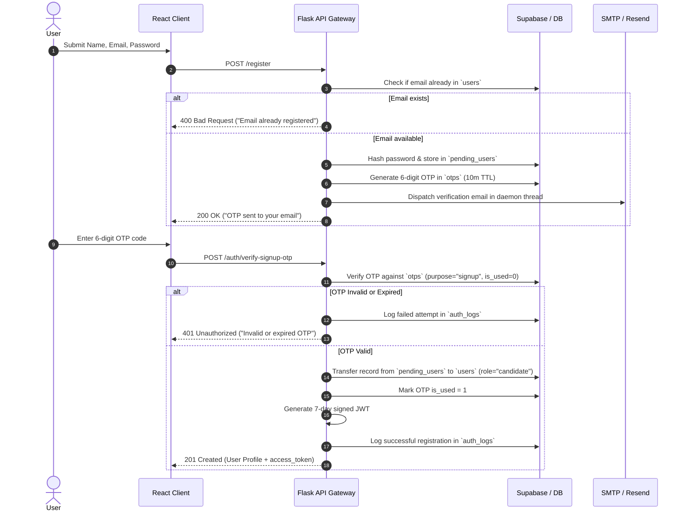
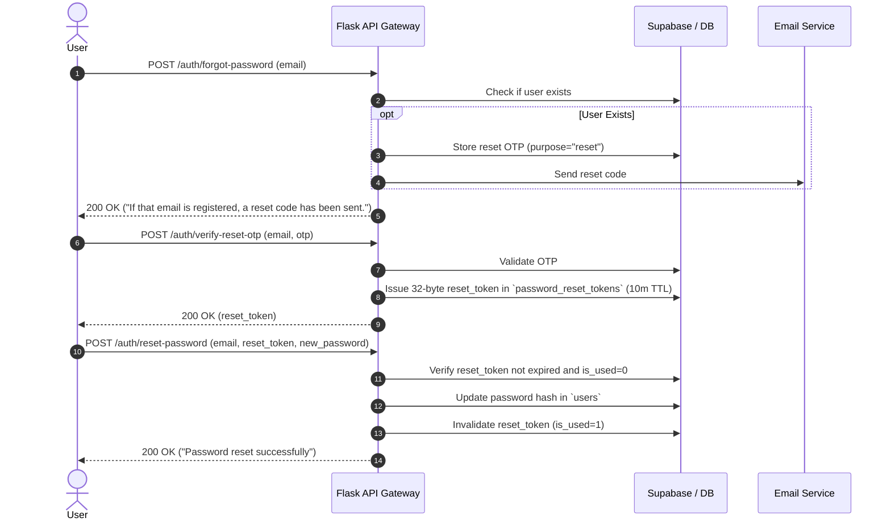

# 🔐 PrepFly Authentication & Access Control Implementation Guide (`AUTHENTICATION.md`)

This guide serves as the definitive reference for authentication, authorization, role-based access control (RBAC), token management, and security policies across the **PrepFly** platform.

---

## 📑 Table of Contents

1. [Authentication & Authorization Overview](#1-authentication--authorization-overview)
2. [User Roles & Permissions Matrix](#2-user-roles--permissions-matrix)
3. [User Registration Flow](#3-user-registration-flow)
4. [Email Verification via OTP](#4-email-verification-via-otp)
5. [Login Flows](#5-login-flows)
6. [Password Reset Flow](#6-password-reset-flow)
7. [Social Login Integration (Google OAuth)](#7-social-login-integration-google-oauth)
8. [Token Management & JWT Lifecycle](#8-token-management--jwt-lifecycle)
9. [Protected Routes & Middleware Architecture](#9-protected-routes--middleware-architecture)
10. [Role-Based Access Control (RBAC)](#10-role-based-access-control-rbac)
11. [User Profile Management](#11-user-profile-management)
12. [Account Deletion & Data Retention](#12-account-deletion--data-retention)
13. [Security Hardening & Threat Mitigations](#13-security-hardening--threat-mitigations)
14. [Environment Variables & Configuration](#14-environment-variables--configuration)
15. [Authentication Testing Checklist](#15-authentication-testing-checklist)
16. [Common Issues & Troubleshooting](#16-common-issues--troubleshooting)

---

## 1. Authentication & Authorization Overview

### 1.1 Architectural Evaluation
PrepFly operates a decoupled Single Page Application (React 19 + Vite on Vercel) consuming a stateless REST API (Flask on Railway) backed by Supabase PostgreSQL and an isolated code execution sandbox.

| Model | Evaluation in PrepFly Context | Verdict |
| :--- | :--- | :--- |
| **Server-Side Sessions (Cookies)** | Requires sticky load balancer sessions or centralized session DB lookups on every API request. Problematic across cross-origin deployments (`prepfly.vercel.app` ↔ `prepfly.up.railway.app`). | ❌ Rejected for primary API calls |
| **Stateful OAuth Delegation** | High latency on every microservice hop, complex tenant federation for offline test suites. | ⚠️ Used only as identity provider (Google ID tokens) |
| **Stateless Signed JWTs (HMAC-SHA256)** | Cryptographically verified at the API gateway without database hits on every route. Carries tenant and role metadata. Extremely resilient, horizontally scalable, and test-friendly. | **✅ Recommended & Implemented** |

### 1.2 Core Security Architecture
* **Identity Verification**: Passwords hashed using Werkzeug's secure PBKDF2/scrypt key derivation (`generate_password_hash`).
* **Multi-Factor OTP Guard**: 6-digit cryptographically generated one-time passwords for signup and login verification.
* **Stateless Authorization Tokens**: Signed HS256 JSON Web Tokens (JWT) with 7-day validity carrying user UUID, email, and role.
* **Audit Logging**: Every authentication event (success or failure) is recorded in `auth_logs` with client IP and authentication method.

---

## 2. User Roles & Permissions Matrix

PrepFly enforces three distinct roles across multi-tenant boundaries:

```text
┌─────────────────┐       ┌───────────────────────┐       ┌────────────────────────┐
│     STUDENT     │       │  ORGANIZATION ADMIN   │       │      SUPER ADMIN       │
│  ("candidate")  │       │ ("Organization Admin")│       │    ("SUPER_ADMIN")     │
└────────┬────────┘       └───────────┬───────────┘       └───────────┬────────────┘
         │                            │                               │
  Practice Interviews          Manage Students & Banks         Global Tenant Governance
  Submit Code Assessments      Download College Reports        Subscription & Revenue
  View Personal Reports        Send Org Announcements          System-wide AI Config
```

| Permission / Capability | Student (`candidate`) | Organization Admin | Super Admin (`SUPER_ADMIN`) |
| :--- | :---: | :---: | :---: |
| **AI Mock Interviews with Ava** | ✅ Own sessions | ❌ | ❌ |
| **Submit Coding Assessments** | ✅ | ❌ | ❌ |
| **Upload Resume & ATS Review** | ✅ | ❌ | ❌ |
| **View Personal Session Reports** | ✅ Own only (IDOR protected) | ❌ | ✅ All |
| **Organization Question Bank** | ❌ (View active only) | ✅ Create, Edit, AI Generate | ✅ Global Bank |
| **Batch Student Management** | ❌ | ✅ Upload, Renew, Delete | ✅ All Organizations |
| **Organization Announcements** | ❌ (Read only) | ✅ Publish to Students | ✅ System Announcements |
| **Subscription & Razorpay Orders**| ❌ | ✅ Renew College Plan | ✅ Manage All Tiers & Invoices|
| **Multi-Tenant Org Creation** | ❌ | ❌ | ✅ Create & Provision Orgs |
| **Platform AI / Cache Config** | ❌ | ❌ | ✅ Purge Cache & Prompts |

---

## 3. User Registration Flow

PrepFly uses a two-step verified registration process to ensure unverified emails never occupy active user records.



### 3.1 Registration Endpoints

#### `POST /register`
* **Request Payload**:
  ```json
  {
    "name": "Anushka Saxena",
    "email": "candidate@prepfly.io",
    "password": "StrongPassword123!"
  }
  ```
* **Validation Rules**:
  - `name`: Non-empty string.
  - `email`: Normalized lowercase string, valid email syntax.
  - `password`: String with minimum length 6 characters.
  - Rate Limit: Max 3 OTP requests per 10 minutes (`check_otp_rate_limit`).
* **Response (200 OK)**:
  ```json
  {
    "message": "OTP sent to your email. Please verify to complete signup."
  }
  ```

#### `POST /auth/verify-signup-otp`
* **Request Payload**:
  ```json
  {
    "email": "candidate@prepfly.io",
    "otp": "481920"
  }
  ```
* **Response (201 Created)**:
  ```json
  {
    "message": "Account created successfully!",
    "email": "candidate@prepfly.io",
    "user_id": "usr_9988112233",
    "name": "Anushka Saxena",
    "role": "candidate",
    "access_token": "eyJhbGciOiJIUzI1NiIsInR5cCI6IkpXVCJ9..."
  }
  ```

---

## 4. Email Verification via OTP

* **Code Format**: 6-digit numeric string generated via `random.randint(100000, 999999)`.
* **Storage**: Stored in the `otps` table:
  ```sql
  CREATE TABLE IF NOT EXISTS otps (
      id BIGSERIAL PRIMARY KEY,
      email TEXT,
      otp TEXT,
      expires_at TEXT,
      is_used INTEGER DEFAULT 0,
      purpose TEXT
  );
  ```
* **Expiration**: Fixed 10-minute window (`datetime.utcnow() + timedelta(minutes=10)`).
* **Single-Use Enforcement**: Verified codes immediately have `is_used` set to `1` in the database.
* **Anti-Backdoor Guard**: Pentest regression testing guarantees master OTP codes (e.g. `123456`, `981103`) are unconditionally rejected with 401 across all auth flows.

---

## 5. Login Flows

PrepFly provides dedicated authentication flows tailored to candidate security and administrative governance.

### 5.1 Student / Candidate Login (Dual-Factor Guarded)
1. **Credentials Validation**: `POST /login` with `email` and `password`.
   - Passwords checked using `check_password_hash`.
   - If credentials pass, system issues a login OTP to the candidate's verified email.
   - Response: `{"message": "Password verified. OTP sent to your email.", "otp_required": true}`.
2. **OTP Confirmation**: `POST /auth/verify-login-otp` with `email` and `otp`.
   - On successful OTP check, returns signed JWT access token.

### 5.2 Organization Admin Login
* **Endpoint**: `POST /api/admin/login`
* **Flow**:
  - Validates credentials against `admin` table (or elevated `users` with `role="Organization Admin"`).
  - Verifies hashed password using constant-time comparison.
  - Returns JWT with `role="Organization Admin"` and bound `organization_id`.

### 5.3 Super Admin Login
* **Endpoint**: `POST /api/superadmin/login`
* **Flow**:
  - Validates against `super_admin` table.
  - Returns 401 on non-existent accounts or bad passwords without leaking user existence.
  - Issues JWT with `role="SUPER_ADMIN"`.

---

## 6. Password Reset Flow



> [!IMPORTANT]
> **Anti-Enumeration Guard**: `POST /auth/forgot-password` unconditionally returns HTTP 200 with the exact same message regardless of whether the email exists in the database.

---

## 7. Social Login Integration (Google OAuth)

PrepFly natively supports Google One Tap and Google Sign-In via Google Identity Services (GIS).

### 7.1 Authentication Protocol
1. Client initializes Google SDK using `VITE_GOOGLE_CLIENT_ID`.
2. Upon user consent, Google returns a signed OpenID Connect ID token (`credential`).
3. Frontend forwards credential to `POST /auth/google/verify`.
4. Backend verifies the token using Google Auth libraries:
   ```python
   idinfo = id_token.verify_oauth2_token(
       credential,
       google_requests.Request(),
       GOOGLE_CLIENT_ID,
       clock_skew_in_seconds=300
   )
   ```
5. Backend retrieves Google subject identifier (`sub`), verified email, name, and profile avatar.
6. The account is automatically linked or provisioned via [`get_or_create_user`](file:///d:/Downloads/interviewsystem/interviewsystem/f_backend/app.py#L1465).
7. Returns a standard PrepFly JWT access token and issues an asynchronous login confirmation email.

---

## 8. Token Management & JWT Lifecycle

### 8.1 JWT Payload Structure
```json
{
  "sub": "usr_7f8a9b0c1d2e",
  "email": "candidate@prepfly.io",
  "role": "candidate",
  "organization_id": "org_college_alpha",
  "exp": 1793616000,
  "iat": 1793011200
}
```

### 8.2 Token Rules & Transmission
* **Algorithm**: `HS256` (HMAC with SHA-256).
* **Signing Key**: Minimum 32-character cryptographically random secret (`JWT_SECRET_KEY`).
* **Validity Period**: 7 days (604,800 seconds).
* **Client Transmission**: Sent on all authenticated requests via the HTTP Authorization header:
  ```http
  Authorization: Bearer <access_token>
  ```
* **Storage Recommendation**:
  - Current Frontend: Maintained in `localStorage` and synchronized across tabs.
  - Proposed Hardening: Transition to `HttpOnly`, `SameSite=Lax`, `Secure` cookies for maximum protection against XSS token harvesting.

---

## 9. Protected Routes & Middleware Architecture

Backend authorization is enforced through Python decorators in [`f_backend/app.py`](file:///d:/Downloads/interviewsystem/interviewsystem/f_backend/app.py):

### 9.1 Decorator Implementations
1. **[`@require_auth`](file:///d:/Downloads/interviewsystem/interviewsystem/f_backend/app.py#L1070)**:
   Extracts `Bearer <token>`, decodes payload using `_get_jwt_secret()`, and attaches it to `request.current_user`. Returns 401 if missing, invalid, or expired.
2. **[`@require_org_admin`](file:///d:/Downloads/interviewsystem/interviewsystem/f_backend/app.py#L1130)**:
   Enforces that `request.current_user.role` is `"Organization Admin"`, `"ADMIN"`, or `"SUPER_ADMIN"`. Returns 403 Forbidden otherwise.
3. **[`@require_super_admin`](file:///d:/Downloads/interviewsystem/interviewsystem/f_backend/app.py#L1107)**:
   Strictly enforces that `request.current_user.role` is `"SUPER_ADMIN"`.

### 9.2 IDOR Defense: Session Ownership Check
For sensitive candidate interview recordings and assessments, route handlers call [`get_owned_session(session_id)`](file:///d:/Downloads/interviewsystem/interviewsystem/f_backend/app.py#L1141):
```python
def get_owned_session(session_id):
    p = _get_optional_user()
    if not p:
        return None, (jsonify({"error": "Authentication required"}), 401)
    
    res = supabase.table("sessions").select("*").eq("session_id", session_id).execute()
    s = res.data[0] if res and res.data else None
    
    # Ownership Check: session.user_id must match token sub OR caller must be Admin
    if not s or (str(s.get("user_id")) != str(p.get("sub")) and p.get("role") not in ("ADMIN", "SUPER_ADMIN")):
        return None, (jsonify({"error": "Session not found"}), 404)
        
    return s, None
```

---

## 10. Role-Based Access Control (RBAC)

### 10.1 Endpoint Permission Matrix
| Route | Method | Required Role | Failure Code | Description |
| :--- | :--- | :--- | :---: | :--- |
| `/update-profile` | GET / PUT | Any Authenticated | `401` | Candidate profile update |
| `/start-interview` | POST | Authenticated Candidate | `401` | Starts AI voice interview |
| `/session/<session_id>`| GET / DELETE | Session Owner or Admin | `404` | IDOR-safe session access |
| `/api/admin/students` | GET / POST | Org Admin / Super Admin | `403` | College student management |
| `/api/admin/questions`| POST | Org Admin / Super Admin | `403` | Question bank creation |
| `/api/superadmin/organizations` | GET / POST | Super Admin Only | `403` | Multi-tenant organization mgmt |
| `/api/cache/clear` | POST | Super Admin Only | `403` | Purge multi-tier cache |

---

## 11. User Profile Management

* **Endpoint**: `PUT /update-profile` (Guarded by `@require_auth`).
* **Updatable Fields**:
  - `name`: Candidate full name.
  - `phone`: Contact phone number.
  - `avatar`: URL to avatar image in Supabase storage.
  - `password`: Re-hashes with `generate_password_hash` if updated.
* **Security Guard**: `role` cannot be escalated via `/update-profile`. Any supplied `role` attribute is strictly scrubbed.

---

## 12. Account Deletion & Data Retention

* **Candidate Account Purge**:
  When a candidate requests account deletion, data is removed in cascading order:
  1. `sessions`: Associated interview responses, scores, and audio recordings.
  2. `coding_submissions`: Problem solutions and runtime reports.
  3. `speech_analyses`: Audio metrics, filler word counts, WPM stats.
  4. `users`: Core profile record deleted from database.
* **Audit Trail**: Security audit records in `auth_logs` and `sandbox_audit.log` retain tenant identifier and timestamp for 90 days to comply with security forensics before automated pruning.

---

## 13. Security Hardening & Threat Mitigations

| Threat | PrepFly Security Defense |
| :--- | :--- |
| **Brute Force Login** | `Limiter` decorator limits login attempts (e.g. 5 per minute per IP). OTP requests throttled to 3 per 10 minutes. |
| **Credential Stuffing** | Constant-time password verification via `check_password_hash` prevents timing attacks. |
| **Master OTP Backdoor** | Pentest regression suite (`test_security_regressions.py`) ensures hardcoded bypass OTPs are blocked. |
| **Token Forgery** | Start-up check requires `JWT_SECRET_KEY` length ≥ 32 chars and rejects default/test keys in production. |
| **IDOR Vulnerabilities** | Explicit `session.user_id == token.sub` authorization check on every session endpoint. |
| **SQL Injection** | SQL identifier regex `^[A-Za-z_][A-Za-z0-9_]*$` strictly validates table and column parameters in query builders. |
| **XSS Attacks** | React auto-escapes rendered content. Trailing backticks and markdown in LLM outputs are sanitized before rendering. |
| **CORS Insecurities** | Cross-Origin Resource Sharing strictly locked to configured `FRONTEND_URL` in production environments. |

---

## 14. Environment Variables & Configuration

### Safe `.env.example`
```env
# Flask Environment
FLASK_ENV=development
PORT=5000

# Cryptographic JWT Secret (Minimum 32 characters in production)
JWT_SECRET_KEY=e4f9b8c3127845d0a6c2918e7b45f1023a8d9e0f1b2c3d4e5f6a7b8c9d0e1f2a

# Google OAuth Integration
GOOGLE_CLIENT_ID=784331767327-sampleclientid.apps.googleusercontent.com

# Supabase PostgreSQL Configuration
SUPABASE_URL=https://sampleproject.supabase.co
SUPABASE_SERVICE_KEY=sb_secret_service_key_min_32_chars

# Transactional Email Transport (SMTP or Resend)
SMTP_SERVER=smtp.gmail.com
SMTP_PORT=587
SMTP_EMAIL=notifications@prepfly.io
SMTP_PASSWORD=sample_app_password_here
RESEND_API_KEY=re_sample_resend_api_key

# Frontend Allowed Origin (for CORS)
FRONTEND_URL=http://localhost:5173
```

---

## 15. Authentication Testing Checklist

Run these automated tests to verify authentication security:

* [x] **Master OTP Rejection**:
  ```powershell
  cd f_backend
  .\venv\Scripts\python.exe -m unittest tests/test_security_regressions.py
  ```
  *(Verifies `test_01_master_otps_rejected_across_all_auth_flows` passes).*
* [x] **Super Admin Authentication**:
  ```powershell
  cd f_backend
  .\venv\Scripts\python.exe -m unittest tests/test_superadmin_auth.py
  ```
  *(Verifies unauthorized emails and bad passwords are rejected with 401).*
* [x] **End-to-End Auth Lifecycle**:
  ```powershell
  cd f_backend
  .\venv\Scripts\python.exe -m unittest tests/integration/test_auth_lifecycle.py
  ```
  *(Verifies registration → OTP verification → profile retrieval → login).*

---

## 16. Common Issues & Troubleshooting

| Symptom | Diagnostic Step | Resolution |
| :--- | :--- | :--- |
| **"Invalid or expired token" (401)** | Check token expiration timestamp (`exp`). | User token expired after 7 days; redirect candidate to `/login`. |
| **"Authentication required" (401)** | Inspect HTTP header in Network tab. | Ensure frontend attaches `Authorization: Bearer <token>`. |
| **"Forbidden: Admin access required" (403)** | Decode token payload and inspect `"role"`. | User has `candidate` role; admin routes require `ADMIN` or `Organization Admin`. |
| **"Too many requests" (429)** | Check `otp_requests` table count. | Exceeded 3 requests per 10 minutes limit. Wait 10 minutes or check Redis limiter. |
| **Google Sign-In "Token Expired / Clock Skew"** | Check system time on backend host. | Verify NTP clock synchronization. PrepFly permits 300s clock skew tolerance. |
| **OTP Email not delivered** | Check backend terminal logs for SMTP error. | Verify Gmail App Password or configure `RESEND_API_KEY` in `f_backend/.env`. |
