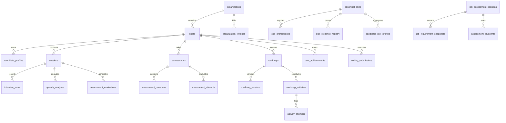

# DATABASE DESIGN & SCHEMA ENCYCLOPEDIA — PREPFLY

**Document Version:** 2.0.0  
**Database Engine:** PostgreSQL 15 (Supabase Managed) with SQLite3 Local Fallback  
**Security Model:** Row Level Security (RLS) with Service-Role Bypass  
**Integrity Standards:** Third Normal Form (3NF) for transactional domains; Denormalized JSONB for immutable turn telemetry  

---

## 1. Entity-Relationship Architecture



---

## 2. Core Relational Schema Encyclopedia

### 2.1 Identity, Multi-Tenancy & Access Control
- **`public.users`:**
  - `id UUID PRIMARY KEY DEFAULT gen_random_uuid()`
  - `email TEXT UNIQUE NOT NULL`
  - `role TEXT NOT NULL DEFAULT 'STUDENT'` (Enum: `STUDENT`, `COLLEGE_ADMIN`, `SUPER_ADMIN`)
  - `organization_id UUID REFERENCES organizations(id) ON DELETE SET NULL`
  - `created_at TIMESTAMPTZ DEFAULT NOW()`
- **`public.organizations`:**
  - `id UUID PRIMARY KEY DEFAULT gen_random_uuid()`
  - `name TEXT NOT NULL`
  - `domain TEXT UNIQUE`
  - `subscription_plan TEXT DEFAULT 'Trial'`
  - `subscription_status TEXT DEFAULT 'ACTIVE'`
  - `trial_start TIMESTAMPTZ`, `trial_end TIMESTAMPTZ`

### 2.2 Live AI Interview Cockpit (`public.sessions`)
- **`public.sessions`:**
  - `id UUID PRIMARY KEY DEFAULT gen_random_uuid()`
  - `session_id TEXT UNIQUE NOT NULL` (Indexed)
  - `user_id TEXT` (Indexed)
  - `active BOOLEAN DEFAULT TRUE` (Indexed)
  - `role TEXT DEFAULT 'Software Engineer'`
  - `category TEXT DEFAULT 'Resume Based'`
  - `difficulty TEXT DEFAULT 'Medium'`
  - `stage TEXT` (Enum: `GREETING`, `TECHNICAL_CORE`, `SYSTEM_DESIGN`, `BEHAVIORAL`, `CLOSING`)
  - `ats_score REAL`
  - `structured_resume TEXT`
  - `questions JSONB DEFAULT '[]'::jsonb`
  - `responses JSONB DEFAULT '[]'::jsonb`
  - `feedbacks JSONB DEFAULT '[]'::jsonb`
  - `scores JSONB DEFAULT '[]'::jsonb`
  - `knowledge_map TEXT DEFAULT '{}'`
  - `consent_given INTEGER DEFAULT 1`
  - `consent_timestamp TIMESTAMPTZ`
  - `privacy_policy_version TEXT DEFAULT 'DPDP-2023-v1.0'`
  - `final_score REAL`, `final_score_100 INTEGER`, `final_grade TEXT`, `final_report TEXT`
  - `storage_path TEXT` (JSON-encoded fallback metadata container)

### 2.3 Diagnostic Assessments & Blueprints
- **`public.assessments`:**
  - `id TEXT PRIMARY KEY` (UUID string)
  - `user_id TEXT NOT NULL` (Indexed)
  - `title TEXT NOT NULL`
  - `assessment_type TEXT DEFAULT 'diagnostic'`
  - `target_role TEXT NOT NULL`
  - `status TEXT DEFAULT 'in_progress'`
  - `score REAL`
  - `total_questions INTEGER DEFAULT 5`
  - `completed_questions INTEGER DEFAULT 0`
  - `summary TEXT`
  - `created_at TIMESTAMPTZ DEFAULT NOW()`, `completed_at TIMESTAMPTZ`
- **`public.assessment_questions`:**
  - `id TEXT PRIMARY KEY` (UUID string)
  - `assessment_id TEXT REFERENCES assessments(id) ON DELETE CASCADE`
  - `skill_id TEXT NOT NULL` (Indexed)
  - `question_text TEXT NOT NULL`
  - `question_type TEXT DEFAULT 'conceptual'`
  - `difficulty TEXT DEFAULT 'Intermediate'`
  - `options JSONB DEFAULT '[]'::jsonb`
  - `expected_concepts JSONB DEFAULT '[]'::jsonb`
  - `rubric JSONB DEFAULT '{}'::jsonb`
  - `order_index INTEGER DEFAULT 1`
- **`public.assessment_attempts`:**
  - `id UUID PRIMARY KEY DEFAULT gen_random_uuid()`
  - `assessment_id TEXT REFERENCES assessments(id) ON DELETE CASCADE`
  - `question_id TEXT REFERENCES assessment_questions(id) ON DELETE CASCADE`
  - `user_id TEXT NOT NULL`
  - `candidate_answer TEXT`
  - `score REAL NOT NULL`
  - `is_correct INTEGER DEFAULT 0`
  - `evaluation_result JSONB`
  - `identified_concepts JSONB`
  - `missing_concepts JSONB`
  - `feedback TEXT`
  - `evaluated_at TIMESTAMPTZ DEFAULT NOW()`

### 2.4 Canonical Skill Taxonomy & Verifiable Evidence Registry
- **`public.canonical_skills` / `public.skills`:**
  - `id TEXT PRIMARY KEY` (Slug: `dsa_arrays`, `ml_model_development`)
  - `name TEXT NOT NULL`
  - `category TEXT NOT NULL`
  - `domain TEXT NOT NULL`
  - `description TEXT`
  - `difficulty_level TEXT DEFAULT 'Intermediate'`
- **`public.skill_prerequisites`:**
  - `skill_id TEXT REFERENCES canonical_skills(id) ON DELETE CASCADE`
  - `prerequisite_skill_id TEXT REFERENCES canonical_skills(id) ON DELETE CASCADE`
  - `PRIMARY KEY (skill_id, prerequisite_skill_id)`
- **`public.skill_evidence_registry`:**
  - `id UUID PRIMARY KEY DEFAULT gen_random_uuid()`
  - `user_id TEXT NOT NULL` (Indexed)
  - `skill_id TEXT NOT NULL` (Indexed)
  - `source_type TEXT NOT NULL` (Enum: `diagnostic_assessment`, `practical_assignment`, `coding_submission`, `ai_interview`, `mock_interview`, `resume_claim`, `project_exposure`)
  - `source_id TEXT NOT NULL`
  - `raw_score REAL` (Nullable for unassessed claims)
  - `normalized_score REAL` (Nullable for claims; 0–100 for assessed evidence)
  - `difficulty TEXT DEFAULT 'Intermediate'`
  - `validity_status TEXT DEFAULT 'VERIFIED_ASSESSED'` (Enum: `CLAIMED_EXPOSURE`, `PROJECT_EXPOSURE`, `VERIFIED_ASSESSED`, `SUPERSEDED`, `INVALID`)
  - `dedupe_key TEXT UNIQUE` (Composite hash preventing identical score inflation)
  - `created_at TIMESTAMPTZ DEFAULT NOW()`

### 2.5 Personalized Roadmaps & Spaced Retrieval
- **`public.roadmaps`:**
  - `id TEXT PRIMARY KEY`
  - `user_id TEXT UNIQUE NOT NULL`
  - `target_role TEXT NOT NULL`
  - `current_version INTEGER DEFAULT 1`
  - `status TEXT DEFAULT 'active'`
  - `total_activities INTEGER DEFAULT 0`, `completed_activities INTEGER DEFAULT 0`
  - `completion_percentage INTEGER DEFAULT 0`
  - `created_at TIMESTAMPTZ DEFAULT NOW()`, `updated_at TIMESTAMPTZ DEFAULT NOW()`
- **`public.roadmap_activities`:**
  - `id TEXT PRIMARY KEY`
  - `roadmap_id TEXT REFERENCES roadmaps(id) ON DELETE CASCADE`
  - `day_number INTEGER NOT NULL` (Indexed)
  - `activity_type TEXT NOT NULL` (Enum: `LEARN`, `PRACTICE`, `CODING`, `MOCK_INTERVIEW`, `ASSESSMENT`, `REVISION`)
  - `title TEXT NOT NULL`
  - `skill_id TEXT NOT NULL`
  - `priority_score REAL DEFAULT 50.0`
  - `estimated_minutes INTEGER DEFAULT 30`
  - `status TEXT DEFAULT 'pending'`
  - `is_pinned BOOLEAN DEFAULT FALSE`

---

## 3. Row Level Security (RLS) Policy Registry

PostgreSQL RLS ensures that client role tokens cannot read or mutate foreign records:

```sql
-- 1. candidate_profiles: Strictly owner-isolated
ALTER TABLE public.candidate_profiles ENABLE ROW LEVEL SECURITY;
CREATE POLICY "Candidate profile access" ON public.candidate_profiles
    FOR ALL USING (auth.uid()::text = user_id)
    WITH CHECK (auth.uid()::text = user_id);

-- 2. sessions: Candidate can only select and update own interview sessions
ALTER TABLE public.sessions ENABLE ROW LEVEL SECURITY;
CREATE POLICY "Candidate session read" ON public.sessions
    FOR SELECT USING (auth.uid()::text = user_id OR user_id IS NULL OR user_id = 'user_default');
CREATE POLICY "Candidate session update" ON public.sessions
    FOR UPDATE USING (auth.uid()::text = user_id);

-- 3. skill_evidence_registry: Read-only for candidates; writes reserved for backend service_role
ALTER TABLE public.skill_evidence_registry ENABLE ROW LEVEL SECURITY;
CREATE POLICY "Candidate evidence read" ON public.skill_evidence_registry
    FOR SELECT USING (auth.uid()::text = user_id);

-- 4. assessments and assessment_attempts: Owner isolated
ALTER TABLE public.assessments ENABLE ROW LEVEL SECURITY;
CREATE POLICY "Assessments owner read" ON public.assessments
    FOR SELECT USING (auth.uid()::text = user_id);

ALTER TABLE public.assessment_attempts ENABLE ROW LEVEL SECURITY;
CREATE POLICY "Assessment attempts owner read" ON public.assessment_attempts
    FOR SELECT USING (auth.uid()::text = user_id);
```

---

## 4. Migration History & Idempotency Audit

The database schema has evolved through 7 tracked, idempotent SQL migrations located in `f_backend/migrations/`:
- `001_prepfly_intelligence_schema.sql`: Core tables for profiles, taxonomy, assessments, and roadmaps.
- `002_ava_interview_engine_schema.sql`: Multi-turn conversational interview state and resume claims.
- `003_career_intelligence_schema.sql`: Job profile modeling, performance snapshots, and gamified achievements.
- `004_job_readiness_assessment_schema.sql`: Job readiness sessions, requirement snapshots, and gap recommendations.
- `005_candidate_intelligence_schema.sql`: Topic assignment progress and cross-pillar readiness aggregates.
- `006_evidence_based_readiness_engine.sql`: Canonical skill taxonomy, evidence registry, and project code probe questions.
- `007_fix_production_schema_missing_columns.sql`: Safe synchronization adding `sessions.active`, `parsed_resumes`, `coding_submissions`, and `speech_analyses` with schema cache notification: `NOTIFY pgrst, 'reload schema';`.

