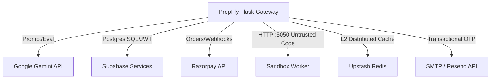

# 🔍 PrepFly Comprehensive Debugging & Troubleshooting Guide (`DEBUGGING.md`)

This guide serves as the definitive reference for diagnosing, isolating, fixing, and verifying issues across all layers of **PrepFly**: Frontend (React + Vite), Backend (Flask + Python), Database (Supabase PostgreSQL & SQLite Mock), Sandbox Execution Worker (Isolated Container), Authentication (JWT & OTP), AI Agents (*Ava*, ATS Engine, Grading System), Caching, and External Integrations.

---

## 📑 Table of Contents

1. [Debugging Overview](#1-debugging-overview)
2. [Common Issues & Failure Taxonomy](#2-common-issues--failure-taxonomy)
3. [Error Messages & Step-by-Step Solutions](#3-error-messages--step-by-step-solutions)
4. [Logging & Log Interpretation](#4-logging--log-interpretation)
5. [Debugging Tools & Techniques](#5-debugging-tools--techniques)
6. [Environment-Specific Debugging](#6-environment-specific-debugging)
7. [AI Agents & LLM Pipeline Debugging](#7-ai-agents--llm-pipeline-debugging)
8. [External API & Integration Debugging](#8-external-api--integration-debugging)
9. [Database Debugging & Data Recovery](#9-database-debugging--data-recovery)
10. [Performance & Latency Debugging](#10-performance--latency-debugging)
11. [Step-by-Step Troubleshooting Workflow](#11-step-by-step-troubleshooting-workflow)
12. [Common Edge Cases & Race Conditions](#12-common-edge-cases--race-conditions)
13. [Feature-Based Debugging Checklists](#13-feature-based-debugging-checklists)
14. [Error Tracking & Monitoring (Sentry / Telemetry)](#14-error-tracking--monitoring-sentry--telemetry)
15. [Prevention & Best Practices](#15-prevention--best-practices)

---

## 1. Debugging Overview

### 1.1 The PrepFly Debugging Philosophy
PrepFly combines real-time AI mock interviews, code execution in untrusted environments, multi-tenant academic organizations, and financial transactions. Debugging follows three tenets:
1. **Zero-Trust Boundary Isolation**: Isolate whether an error occurs in the browser client, Flask API gateway, untrusted code sandbox, database layer, or third-party AI/payment APIs.
2. **Defensive Observability**: Leverage structured logging, HTTP status semantics, correlation IDs, and telemetry endpoints (`/health`, `/api/cache/stats`, sandbox `/metrics`).
3. **Reproducibility with Minimal State**: Replicate bugs using isolated unit/integration tests (`tests/test_*.py`) or minimal cURL payloads before touching code.

### 1.2 The 6-Step Triage Lifecycle
```text
[1. Identify]  ---> [2. Reproduce] ---> [3. Isolate] ---> [4. Diagnose] ---> [5. Resolve] ---> [6. Verify]
 Capture error       Replicate with     Pinpoint layer    Inspect traces,    Minimal safe      Run regression
 & user impact       minimal payload    (FE, BE, DB, AI)  stack, & logs      patch             suite (86 tests)
```

### 1.3 Distinguishing Failure Types
* **Application Bug**: Deterministic syntax errors, uncaught exceptions (`AttributeError`, `TypeError`), broken UI state management.
* **Configuration Issue**: Missing or malformed environment variables (`.env`), invalid JWT secret length, mismatched port bindings.
* **Infrastructure Failure**: Sandbox Docker daemon offline, DNS failure resolving Supabase/Redis hosts, port conflicts (e.g. 5000 or 5050 occupied).
* **External Service Outage**: Google Gemini 429 quota exhaustion or 400 invalid key, Razorpay API authentication failure, SMTP port timeouts.

---

## 2. Common Issues & Failure Taxonomy

| Category | Primary Symptoms | Root Cause Areas |
| :--- | :--- | :--- |
| **Frontend** | Blank white screen, infinite spinner on interview start, CORS errors in console | Missing Vite env vars, uncaught React render exceptions, unreachable backend URL. |
| **Backend API** | HTTP 500 Internal Server Error, silent request failure, 401 Unauthorized | Uncaught exception in route, missing `_need()` environment variable, invalid JWT claims. |
| **Database** | `sqlite3.OperationalError: database is locked`, Supabase DNS timeout, missing table errors | High SQLite write concurrency in local mock, stale schema migration, invalid column identifier. |
| **Authentication** | "Invalid or expired OTP", "Invalid token signature", 403 Forbidden on Admin routes | OTP expired (>10 mins), JWT secret altered between restarts, role mismatch (`student` vs `admin`). |
| **AI Interview Engine** | Ava repeats fallback questions, prompt parsing fails, latency spikes > 5s | Invalid Gemini API key, rate limits exceeded, malformed JSON returned by LLM prompt. |
| **Sandbox Worker** | HTTP 502 / Connection Refused on `:5050`, code execution hangs indefinitely | Docker worker container stopped, CPU/wall-clock limit exceeded, `ISOLATED_SANDBOX_SECRET` mismatch. |
| **Payment & Billing** | "Invalid signature", webhooks failing with 400, trial status not updating | Razorpay HMAC secret mismatch, currency sent in rupees instead of paise, unhandled webhook event. |
| **Cache Subsystem** | Stale data returned after DB update, cache stampede during traffic spikes | Missing `@cache_invalidate` on mutation route, Redis unreachable (falling back to memory). |

---

## 3. Error Messages & Step-by-Step Solutions

### 3.1 Backend: Missing Required Environment Variable
* **Symptom / Message**:
  ```text
  RuntimeError: JWT_SECRET_KEY is required
  # OR
  RuntimeError: Insecure JWT_SECRET_KEY: In production, JWT_SECRET_KEY must be a cryptographically random secret of at least 32 characters!
  ```
* **Likely Causes**:
  1. `f_backend/.env` file is missing or unreadable.
  2. `JWT_SECRET_KEY` is shorter than 32 characters or starts with `test-` while `FLASK_ENV=production`.
* **Diagnostic Steps**:
  1. Inspect `f_backend/.env` exist status:
     ```powershell
     Test-Path f_backend/.env
     ```
  2. Check the character length of `JWT_SECRET_KEY`.
* **Step-by-Step Solution**:
  1. Create or open `f_backend/.env`.
  2. Generate a secure 64-character secret:
     ```powershell
     python -c "import secrets; print(secrets.token_hex(32))"
     ```
  3. Set `JWT_SECRET_KEY=<generated_hex>` in `f_backend/.env`.
* **Verification Procedure**:
  Run backend test runner:
  ```powershell
  cd f_backend
  .\venv\Scripts\python.exe -m unittest tests/test_security_regressions.py
  ```
* **Prevention**: Keep `f_backend/.env.example` updated with variable templates and run startup configuration validation via `_need()`.

---

### 3.2 Sandbox Execution: Connection Refused on Port 5050
* **Symptom / Message**:
  ```text
  requests.exceptions.ConnectionError: HTTPConnectionPool(host='127.0.0.1', port=5050): Max retries exceeded with url: /execute
  ```
* **Likely Causes**:
  1. The Docker sandbox container `prepfly-sandbox-worker` is stopped or not running.
  2. `ISOLATED_SANDBOX_SECRET` in `f_backend/.env` does not match the worker container's secret.
* **Diagnostic Steps**:
  1. Verify if port 5050 is listening:
     ```powershell
     netstat -ano | findstr :5050
     ```
  2. Check Docker container status:
     ```bash
     docker ps -a --filter "name=prepfly-sandbox-worker"
     ```
  3. Query health endpoint:
     ```powershell
     curl http://127.0.0.1:5050/health
     ```
* **Step-by-Step Solution**:
  1. Start the sandbox worker service:
     ```bash
     cd sandbox_worker
     docker-compose up -d --build
     ```
  2. If testing locally without Docker, start the development server directly:
     ```powershell
     cd sandbox_worker
     python server.py
     ```
* **Verification Procedure**:
  Submit a test execution payload:
  ```bash
  curl -X POST http://127.0.0.1:5050/execute \
    -H "Content-Type: application/json" \
    -H "X-Sandbox-Secret: prepfly-sandbox-dev-secret-32-chars-long-minimum" \
    -d "{\"language\":\"python\",\"code\":\"print(1+1)\",\"test_cases\":[{\"input\":\"\",\"expected_output\":\"2\"}]}"
  ```
  Expected output: `{"results":[{"passed":true,"output":"2"}]}`.

---

### 3.3 Database: SQLite Database is Locked
* **Symptom / Message**:
  ```text
  sqlite3.OperationalError: database is locked
  ```
* **Likely Causes**:
  1. A long-running write transaction in `local_db.sqlite` without commit.
  2. Concurrent test threads accessing SQLite without WAL (Write-Ahead Logging) mode enabled.
* **Diagnostic Steps**:
  1. Check WAL mode status in SQLite:
     ```powershell
     cd f_backend
     python -c "import sqlite3; conn=sqlite3.connect('local_db.sqlite'); print(conn.execute('PRAGMA journal_mode').fetchone()[0])"
     ```
* **Step-by-Step Solution**:
  1. Enable WAL mode and extended busy timeouts (already handled in `local_supabase.py`):
     ```python
     conn.execute("PRAGMA journal_mode=WAL")
     conn.execute("PRAGMA busy_timeout = 60000")
     ```
  2. Terminate any orphaned python processes holding locks:
     ```powershell
     Get-Process -Name python | Where-Object { $_.Path -like "*interviewsystem*" } | Stop-Process -Force
     ```
* **Verification Procedure**:
  Run the full test suite:
  ```powershell
  cd f_backend
  .\venv\Scripts\python.exe run_all_tests.py
  ```

---

### 3.4 AI Interview: Gemini API 400 Invalid Argument / Key Invalid
* **Symptom / Message**:
  ```text
  Error calling model 'gemini-2.5-flash' (INVALID_ARGUMENT): API key not valid. Please pass a valid API key.
  ```
* **Likely Causes**:
  1. Expired or rotated `GEMINI_API_KEY` in `f_backend/.env`.
  2. Quota exhausted on primary key.
* **Diagnostic Steps**:
  1. Check terminal output for the fallback notice:
     ```text
     [GEMINI INIT] Successfully initialized model 'gemini-2.5-flash'
     Dynamic question generation notice (INVALID_ARGUMENT), selecting phase-appropriate question:
     ```
  2. Notice that the system gracefully falls back to deterministic curated questions from `ai_service.py`!
* **Step-by-Step Solution**:
  1. Rotate key in `f_backend/.env` using one of the backup keys (`GEMINI_INTERVIEW_KEY`, `GEMINI_CODING_KEY`, or `BACKUP_GEMINI_API_KEY`).
  2. Restart Flask application.
* **Verification Procedure**:
  Test generation endpoint:
  ```powershell
  cd f_backend
  .\venv\Scripts\python.exe -m unittest tests/test_ai_service.py
  ```

---

### 3.5 Payment: Razorpay Webhook Signature Verification Failed
* **Symptom / Message**:
  ```text
  {"error": "Invalid signature"}, HTTP 400
  ```
* **Likely Causes**:
  1. `RAZORPAY_KEY_SECRET` in `.env` does not match the webhook signing secret configured in the Razorpay dashboard.
  2. Request body read as decoded string instead of raw bytes before HMAC calculation.
* **Diagnostic Steps**:
  1. Verify HMAC calculation logic in `f_backend/services/payment_service.py`:
     ```python
     generated_signature = hmac.new(
         secret.encode("utf-8"),
         payload_body.encode("utf-8"),
         hashlib.sha256
     ).hexdigest()
     ```
* **Step-by-Step Solution**:
  1. Ensure raw request data is passed without mutation.
  2. Update `RAZORPAY_KEY_SECRET` to match your Razorpay API Dashboard webhook secret.
* **Verification**:
  Run payment service regression tests:
  ```powershell
  cd f_backend
  .\venv\Scripts\python.exe -m unittest tests/test_payment_service.py
  ```

---

## 4. Logging & Log Interpretation

### 4.1 Log File Locations & Destinations
| Component | Primary Log Location / Stream | Format |
| :--- | :--- | :--- |
| **Flask API Server** | `stdout` / `stderr` / Gunicorn access log | `[LEVEL] YYYY-MM-DD HH:MM:SS - Module - Message` |
| **Sandbox Execution** | `sandbox_audit.log` (root & container `/app/sandbox_audit.log`) | Structured JSON Lines (`JSONL`) |
| **Frontend Browser** | Chrome DevTools Console (`F12`) | Browser Console & Network tab JSON responses |
| **Local SQLite Mock** | Terminal warnings `[WARNING] Using local SQLite fallback database` | Standard error stream |
| **Cache Engine** | `prepfly.cache` logger / terminal output | `[AI CACHE HIT] Served cached response for hash ...` |

### 4.2 Interpreting Structured Sandbox Audit Logs
Every code execution inside the worker emits an immutable audit event:
```json
{
  "timestamp": "2026-11-02T08:55:00.123456Z",
  "event_type": "code_execution",
  "job_id": "job_a1b2c3d4",
  "client_ip": "127.0.0.1",
  "user_id": "usr_998811",
  "language": "python",
  "problem_id": "lru-cache",
  "status": "success",
  "execution_time_ms": 42.1,
  "memory_kb": 2048.0,
  "security_flags": [],
  "isolation_mode": "container"
}
```
* **If `status: "timeout"`**: Code exceeded the 4.0s wall clock limit (infinite loop).
* **If `security_flags` contains `"process_limit_exceeded"`**: Fork bomb attempt blocked.
* **If `security_flags` contains `"network_attempt_blocked"`**: Socket creation blocked by security profile.

### 4.3 Safe Logging Rules (GDPR & Security)
> [!CAUTION]
> **NEVER LOG CREDENTIALS**:
> 1. Passwords, password hashes, and OTP plaintexts must never be printed to stdout or written to disk.
> 2. `JWT_SECRET_KEY`, `RAZORPAY_KEY_SECRET`, and `GEMINI_API_KEY` must always be masked (e.g. `sk_...4F2A`).
> 3. Resumes containing candidate PII (phone numbers, addresses) must only have their SHA-256 hashes logged.

---

## 5. Debugging Tools & Techniques

### 5.1 Frontend Developer Tools
* **Network Tab**: Filter by `Fetch/XHR`. Look for requests to `/start-interview`, `/get-hint`, `/next`, or `/api/coding/submit`. Inspect **Headers** (`Authorization: Bearer <jwt>`, `X-Cache: HIT/MISS`) and **Response**.
* **Console Tab**: Check for React hydration mismatches, WebRTC signaling failures (`RTCPeerConnection`), or unhandled promise rejections.
* **Application Storage Tab**: Inspect `localStorage` for `token`, `role`, and `user_email`. Verify token expiry using [jwt.io](https://jwt.io) (do not paste production tokens with sensitive secrets).

### 5.2 Backend Flask Debugging
* **VS Code / Cursor Python Debugger**:
  Set `"FLASK_DEBUG": "1"` in development and attach the debugger to `f_backend/app.py`.
  Configure `.vscode/launch.json`:
  ```json
  {
    "name": "Python: Flask Backend",
    "type": "debugpy",
    "request": "launch",
    "module": "flask",
    "env": {
      "FLASK_APP": "app.py",
      "FLASK_DEBUG": "1"
    },
    "cwd": "${workspaceFolder}/f_backend",
    "args": ["run", "--port", "5000", "--no-reload"]
  }
  ```

### 5.3 Database Inspection Commands
* **Inspect Local SQLite Database**:
  ```powershell
  cd f_backend
  python -c "import sqlite3; conn = sqlite3.connect('local_db.sqlite'); print('Tables:', [r[0] for r in conn.execute('SELECT name FROM sqlite_master WHERE type=\'table\'').fetchall()])"
  ```
* **Check Unverified OTPs**:
  ```powershell
  python -c "import sqlite3; conn = sqlite3.connect('local_db.sqlite'); print(conn.execute('SELECT email, otp, expires_at, is_used FROM otps ORDER BY id DESC LIMIT 5').fetchall())"
  ```

---

## 6. Environment-Specific Debugging

| Dimension | Local Development | Staging / Test | Production |
| :--- | :--- | :--- | :--- |
| **Frontend Host** | `http://localhost:5173` | Vercel Preview URL | `https://prepfly.vercel.app` |
| **Backend Host** | `http://localhost:5000` | Railway Staging | `https://prepfly.up.railway.app` |
| **Database** | `local_db.sqlite` (mock) | Supabase Staging | Supabase Managed PostgreSQL |
| **Cache & Limiter** | In-Memory LRU (`memory://`) | Upstash Redis | Multi-node Redis Cluster |
| **Code Execution** | Local process or Docker | Docker Compose Worker | Hardened Isolated Container VM |
| **JWT Secrets** | 32-char test secret | 32-char staging secret | Cryptographic 256-bit Random Key |

### Reproducing Production Issues Safely
1. **Never copy live candidate resumes or production DB dumps to unencrypted developer laptops.**
2. Use synthetic mock data:
   * Mock User: `student_test@prepfly.io`
   * Mock Org: `org_test_institution`
3. Export failed test case inputs without PII into unit test fixtures in `tests/test_*.py`.

---

## 7. AI Agents & LLM Pipeline Debugging

### 7.1 Architecture of AI Components
PrepFly uses specialized AI components powered by `langchain-google-genai` and `gemini-2.5-flash`:
1. **Ava Recruiter Agent** (`ai_service.py`): Multi-stage interview agent navigating 7 progressive phases.
2. **ATS Intelligence Engine** (`ats_engine.py` & `resume_service.py`): Resume parser, ATS scorer, keyword matcher.
3. **Comprehensive Grading System** (`feedback_service.py` & `grading_service.py`): 6-metric evaluation (Technical, Coding, Projects, Behavioral, Communication, Confidence).

### 7.2 Debugging AI Agent Failures & Timeouts
* **Issue: Ava asks repetitive or irrelevant questions**:
  * Check `previous_questions` array passed to `generate_dynamic_question`. If the frontend fails to append previous questions, Ava lacks conversation history.
  * Verify `STAGES` phase calculation in [`get_current_stage(question_index)`](file:///d:/Downloads/interviewsystem/interviewsystem/f_backend/services/ai_service.py#L44).
* **Issue: JSON Output Truncation from Gemini**:
  * Large evaluations can exceed max output tokens.
  * PrepFly implements a monkey-patch in `app.py` ([`patched_invoke`](file:///d:/Downloads/interviewsystem/interviewsystem/f_backend/app.py#L97)) to join multipart chunks and sanitize trailing markdown backticks before `json.loads()`.
* **Issue: AI Response Caching Verification**:
  * Verify whether an AI prompt is hitting cache:
    ```bash
    curl http://localhost:5000/api/cache/stats
    ```
    Inspect `l1_memory.hits` and `l1_memory.items_count`.

---

## 8. External API & Integration Debugging



### 8.1 Google Gemini API
* **Failure: 429 Resource Exhausted**: Rate limit hit for the project quota. The system will switch to deterministic fallback questions from `PHASE_4_FALLBACKS`.
* **Verification**: Call `generate_hint()` in `tests/test_ai_service.py`.

### 8.2 Razorpay Payment Gateway
* **Failure: Order Creation Auth Error**:
  ```text
  Razorpay client notice (fallback order_id generated): Authentication failed
  ```
  Occurs when `RAZORPAY_KEY_ID` or `RAZORPAY_KEY_SECRET` are invalid. In non-production environments, PrepFly generates a fallback test order ID (`order_test_...`) to allow local integration tests to proceed without live merchant credentials.

### 8.3 Isolated Sandbox Worker
* **Failure: 429 User Quota Exceeded**:
  Candidates submitting code more than 15 times/minute receive a structured quota message with `retry_after`.
  Check `sandbox_worker/quota.py` and inspect active quota windows.

---

## 9. Database Debugging & Data Recovery

### 9.1 Schema Validation & Tables
The database schema (`supabase_schema.sql`) contains 19 relational tables. When diagnosing database issues, verify the following core table dependencies:

```text
users  <---  students  <---  sessions  <---  speech_analyses
  │             │
  ▼             ▼
admin  <--- organization <--- question_bank / announcements
                │
                ▼
          subscription / payment / invoice
```

### 9.2 Diagnosing Connection Issues
* **Cloud Supabase Timeout**: If DNS resolution fails, check network connectivity. In development and test environments, `local_supabase.py` intercepts requests and routes queries to `local_db.sqlite`.
* **Corrupted Schema / Resetting Local SQLite Database**:
  If the local database enters an unrecoverable state during testing:
  ```powershell
  cd f_backend
  # Backup existing database
  Copy-Item local_db.sqlite local_db.sqlite.bak
  # Remove and allow SQLiteSupabaseMock to auto-rebuild schema
  Remove-Item local_db.sqlite
  .\venv\Scripts\python.exe -m unittest tests/test_security_regressions.py
  ```

---

## 10. Performance & Latency Debugging

### 10.1 Diagnostic Profiling Strategy
1. **API Latency Profiling**: Use the `@cached` decorator to cache endpoints with high compute costs.
2. **AI Generation Latency**: Normal Gemini round trips take 1,500ms – 3,000ms. Caching identical question hints reduces this to **0.2ms**.
3. **Database Slow Queries**:
   * Inspect unindexed lookups on `sessions.user_id` or `students.organization_id`.
   * Add indexes if tables exceed 10,000 rows:
     ```sql
     CREATE INDEX IF NOT EXISTS idx_sessions_user_id ON sessions(user_id);
     CREATE INDEX IF NOT EXISTS idx_students_org_id ON students(organization_id);
     ```

### 10.2 Cache Performance Monitoring
Check cache performance anytime via:
```bash
curl -X GET http://localhost:5000/api/cache/stats
```
Expected output:
```json
{
  "architecture": "Two-Tier (L1 In-Memory + L2 Distributed Redis)",
  "overall_hit_ratio_percent": 88.5,
  "status": "healthy",
  "total_hits": 145,
  "total_misses": 19,
  "l1_memory": {
    "engine": "InMemoryLRU",
    "items_count": 42,
    "max_size": 3000
  }
}
```

---

## 11. Step-by-Step Troubleshooting Workflow

Follow this 10-step protocol to solve any bug:

```text
 1. Capture exact HTTP method, route, request body, headers, and status code.
 2. Replicate locally using a curl command or unit test.
 3. Check application logs (Flask stderr, browser console, sandbox_audit.log).
 4. Identify the failure domain (Frontend, Gateway, Sandbox, AI, DB, Auth).
 5. Formulate a testable hypothesis.
 6. Inspect relevant code paths using breakpoints or print traces.
 7. Apply the minimal targeted fix adhering to architectural rules.
 8. Run unit test suite: `python -m unittest tests/test_<module>.py`.
 9. Run master test suite: `python run_all_tests.py` (Must pass 86/86 tests).
10. Verify in browser UI and commit fix with regression test.
```

---

## 12. Common Edge Cases & Race Conditions

* **Concurrent OTP Submissions**: If a user double-clicks "Verify OTP", the first request marks `is_used = 1` in `otps`. The second request receives 401. Ensure frontend disables submit buttons on submit (`isSubmitting` state).
* **Resume Text Extraction Failure**: Corrupt or scanned PDFs with no OCR text return empty strings. `resume_service.py` catches this and returns a structured fallback profile with missing fields instead of throwing an unhandled 500 error.
* **Sandbox Timeout during Infinite Loops**: Untrusted user code like `while True: pass` triggers a 4.0s wall-clock timeout. Process group `SIGKILL` kills all subprocesses, preventing CPU lockups.
* **Token Expiration during Long Interviews**: Student interviews lasting > 60 minutes may experience token expiration. Ensure client-side refreshes tokens or handles 401 by prompting re-authentication without clearing the session state.

---

## 13. Feature-Based Debugging Checklists

### 13.1 AI Voice Mock Interview (*Ava*)
- [ ] Backend route `/start-interview` returns valid `session_id` and initial question.
- [ ] Route `/next` receives `session_id`, `question_index`, and candidate `response`.
- [ ] Ava transitions phases according to [`get_current_stage()`](file:///d:/Downloads/interviewsystem/interviewsystem/f_backend/services/ai_service.py#L44).
- [ ] Route `/get-hint` returns helpful guidance within 100ms on cache hit.
- [ ] Route `/end-interview` computes comprehensive 6-metric grading and generates report.

### 13.2 Isolated Coding Sandbox
- [ ] Worker container is running (`docker ps` shows `prepfly-sandbox-worker`).
- [ ] Health check `http://127.0.0.1:5050/health` returns status `healthy`.
- [ ] Route `/api/coding/submit` passes `X-Sandbox-Secret` to port 5050.
- [ ] Hidden test cases are evaluated without exposing expected output in client response.
- [ ] Audit log entry recorded in `sandbox_audit.log`.

### 13.3 Super Admin & Organization Subscriptions
- [ ] Super Admin login `/api/superadmin/login` verifies against authorized email list.
- [ ] Organization creation `/api/superadmin/organizations` auto-provisions 10-day trial.
- [ ] Subscription status check [`get_org_subscription_status()`](file:///d:/Downloads/interviewsystem/interviewsystem/f_backend/services/subscription_service.py#L12) correctly calculates `days_remaining`.
- [ ] Expired organizations receive `is_blocked = true` and are blocked from student interviews.

---

## 14. Error Tracking & Monitoring (Sentry / Telemetry)

### 14.1 Sentry Configuration
PrepFly backend includes native Sentry SDK initialization in `f_backend/app.py`:
```python
import sentry_sdk
from sentry_sdk.integrations.flask import FlaskIntegration

sentry_dsn = os.getenv("SENTRY_DSN")
if sentry_dsn:
    sentry_sdk.init(
        dsn=sentry_dsn,
        integrations=[FlaskIntegration()],
        traces_sample_rate=float(os.getenv("SENTRY_TRACES_SAMPLE_RATE", "1.0")),
        environment=os.getenv("FLASK_ENV", "development"),
    )
```

### 14.2 Health & Telemetry Endpoints
* **Application Health**: `GET /health` → `{"status": "ok", "timestamp": "..."}`
* **Cache Telemetry**: `GET /api/cache/stats` → Returns hit ratio, items count, memory utilization.
* **Sandbox Metrics**: `GET http://127.0.0.1:5050/metrics` → Returns active workers, queue depth, timeouts.

---

## 15. Prevention & Best Practices

1. **Static Analysis & Ruff Linting**: Run static integrity checks before every pull request:
   ```bash
   python -m ruff check . --select F821,E9,F811
   ```
2. **Automated Master Test Runner**: Never deploy changes without running all unit & integration tests:
   ```powershell
   cd f_backend
   .\venv\Scripts\python.exe run_all_tests.py
   ```
   *(Must pass all 86 unit and integration tests with zero failures).*
3. **Graceful Degradation**: Always provide fallback modes for external dependencies:
   * Google Gemini failure → Curated interview question tracks.
   * Redis downtime → L1 thread-safe in-memory cache.
   * Supabase network isolation → Local SQLite mock.
4. **Defensive API Contracts**: Always validate request payloads with explicit 400 responses for missing required fields before processing business logic.
