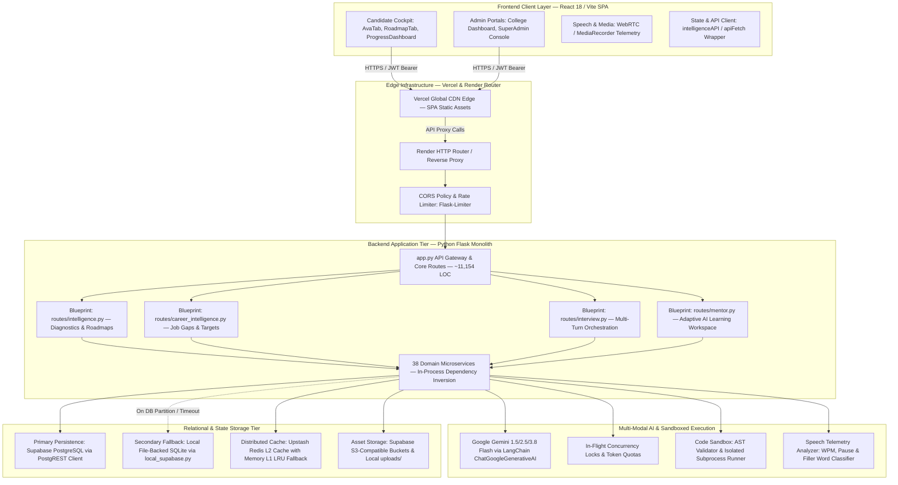

# SYSTEM ARCHITECTURE — PREPFLY ENTERPRISE PLATFORM

**Document Version:** 2.0.0  
**Status:** Senior Staff Software Engineering Production Audit  
**Author:** Staff Software Architect  
**Topology:** Dual-Sided AI Mock Interview, Adaptive Preparation & B2B Institutional Readiness Engine  

---

## 1. High-Level System Architecture & Topology

PrepFly is engineered as an enterprise-grade technical interview simulation, skill diagnostics, and continuous career intelligence SaaS application. The platform provides a dual-facing experience:
1. **Candidate Technical Cockpit:** Conducting 15-minute multi-turn voice/code technical interviews (Ava AI), adaptive diagnostic assessments, continuous progress tracking, and personalized spaced retrieval roadmaps.
2. **Multi-Tenant College/Enterprise Portal:** Serving university placement cells and corporate recruitment teams with cohort-level readiness analytics, skill distribution heatmaps, candidate screening exports, and automated GST billing.



---

## 2. Component Inventory & Responsibility Breakdown

### 2.1 Frontend Client Architecture (`f_frontend/`)
- **Technology Stack:** React 18.2, Vite 6.3.5, Tailwind CSS, Lucide Icons, Canvas-Confetti.
- **Entry Points:**
  - `src/main.jsx`: React DOM root mounting and global providers.
  - `src/App.jsx`: Top-level route distributor and authentication session provider.
  - `src/Dashboard.jsx`: Role-aware shell switching between Student, College Admin, and SuperAdmin dashboards.
- **Core Feature Tabs (`src/components/` & `src/components/Intelligence/`):**
  - `AvaTab.jsx` (~2,640 LOC): Live multi-turn AI interview simulation featuring voice activity detection (VAD), live audio streaming, speech-to-text, in-interview question rendering, and real-time report display.
  - `RoadmapTab.jsx` (~662 LOC): Personalized preparation roadmap, SM-2 spaced retrieval revision cards, and daily activity completion tracking.
  - `DiagnosticAssessmentModal.jsx` (~281 LOC): Modal runner for baseline competency calibration, question progression, and rubric evaluation scorecards.
  - `JobPreparationTab.jsx` (~900 LOC): Job Description (JD) ingestion, 6-category requirement extraction, and job-specific candidate gap analysis.
  - `ProgressDashboard.jsx` (~846 LOC): Candidate intelligence cockpit rendering decoupled proficiency, confidence, coverage, 4 competency pillars, and verified weakness remediation.
  - `CodingTab.jsx`: Sandboxed coding environment with language selection, standard input configuration, and test case execution.

### 2.2 Backend Application Architecture (`f_backend/`)
- **Technology Stack:** Python 3.11, Flask 3.0, Gunicorn 21.2, PyJWT, LangChain Google GenAI, Supabase Python SDK, SQLite3.
- **Application Core:**
  - `app.py` (~11,154 LOC): Central gateway registering blueprints, CORS configurations, rate-limiting handlers, authentication endpoints, resume upload pipelines, payment webhooks, and legacy compatibility layers.
  - `local_supabase.py`: Transparent PostgreSQL-to-SQLite compatibility proxy (`SQLiteSupabaseMock` and `RealBuilderWrapper`) providing zero-downtime offline capabilities.
- **Domain Blueprints (`routes/`):**
  - `routes/intelligence.py` (~732 LOC): Candidate profiling, skill taxonomy catalog, diagnostic assessment sessions, deterministic personalized roadmaps, and spaced revision scheduling.
  - `routes/career_intelligence.py` (~707 LOC): Job target ingestion, JD requirement extraction, candidate evidence aggregation, and job readiness scorecards.
  - `routes/interview.py` (~450 LOC): Ava turn orchestration, live audio streaming, hint synthesis, and speech telemetry extraction.
  - `routes/mentor.py` (~600 LOC): Adaptive AI learning workspace, 7-step pedagogical curriculum, and persistent conversational mentor drawer.

### 2.3 Domain Services Registry (`services/`)
The platform encapsulates business rules within 38 specialized domain services:
1. `candidate_intelligence_engine.py`: Unified intelligence aggregator compiling multi-modal telemetry into institutional readiness scores.
2. `role_readiness_engine.py`: Role-specific readiness evaluator applying 3-tier requirement weights (`mandatory: 1.5x`, `preferred: 1.0x`, `supporting: 0.7x`).
3. `evidence_scoring_engine.py`: Pure mathematical calculator for decoupled proficiency, confidence, coverage, and 90-day recency decay.
4. `evidence_registry_service.py`: Centralized audit registry persisting immutable candidate evidence records.
5. `weakness_detection_engine.py`: Evidence-gated weakness detector strictly requiring verified assessment scores $< 60\%$.
6. `roadmap_engine.py` (~1,787 LOC): `PersonalizedRoadmapEngine`, `RecommendationEngine`, and `SchedulingEngine` enforcing topological DAG ordering and daily capacity limits.
7. `assessment_service.py` (~722 LOC): Diagnostic assessment orchestration, question rotation, and attempt evaluation against rubrics.
8. `skill_taxonomy_service.py` (~1,041 LOC): Canonical taxonomy defining 45+ engineering skills, prerequisites, and category groupings.
9. `ai_service.py`: Resilient Gemini LLM caller with exponential backoff and candidate model fallback chains.
10. `payment_service.py` & `invoice_service.py`: Razorpay order creation, HMAC-SHA256 signature verification, and Indian 18% GST invoice generation.

---

## 3. Critical User Journey Traces

### Journey 1: Resume Upload to Live Ava AI Interview
```
[User uploads PDF in AvaTab.jsx]
       │
       ▼ (multipart/form-data)
POST /upload (app.py:2005)
       │──> Validates file extension (.pdf, .docx) & affirmative DPDP consent (consent_given=1)
       │──> Parses resume via extract_text_from_pdf & parse_resume_content (ATS scoring)
       │──> Generates UUID session_id and constructs initial session dictionary
       │──> Persists to Supabase public.sessions table (with local SQLite fallback)
       │──> Validates persisted flag == True before returning HTTP 200
       ▼
[Frontend stores session_id in React state]
       │
       ▼ (JSON payload)
POST /start-interview (app.py:2228)
       │──> Verifies session ownership via get_owned_session(session_id) (IDOR check)
       │──> Checks session.active status (rejects 0/False with HTTP 404)
       │──> Generates Stage 1 introductory question via generate_dynamic_question
       │──> Updates sessions record with state ASKING, turn_count=0
       │──> Returns question #1, stage, and total_questions (10)
       ▼
[Candidate speaks answer -> Audio recorded via MediaRecorder]
       │
       ▼ (JSON payload with base64 audio / transcript)
POST /next (app.py:2308)
       │──> Obtains _SESSION_IN_FLIGHT_LOCK to block concurrent duplicate requests
       │──> Detects conversational intents (repeat, clarify, pause, early exit)
       │──> Concurrently executes evaluation (fut_fb) and next-question generation (fut_q)
       │──> Appends response, feedback, and score to session audit history
       │──> Updates relational knowledge_map in database
       │──> Returns next_question, question_number, and live metrics
       ▼
POST /end-interview (app.py:2841)
       │──> Fast-compiles (<1ms) multi-dimensional scorecard from recorded feedbacks
       │──> Persists final_score, final_grade, and final_report to sessions
       │──> Sets active = False to prevent session replay attacks
       │──> Returns executive candidate evaluation scorecard
```

### Journey 2: Diagnostic Baseline Assessment to Adaptive Preparation Roadmap
```
[Candidate clicks Start Diagnostic in RoadmapTab.jsx]
       │
       ▼ (POST /api/assessment/start)
start_diagnostic_assessment (routes/intelligence.py:223)
       │──> Resolves user_id from JWT token context
       │──> Retrieves target_role and experience_level from candidate_profiles
       │──> Calls AssessmentService.start_diagnostic_assessment
       │──> Generates assessment record and inserts 5 balanced question items
       │──> Returns assessment metadata and question array to client
       ▼
[Candidate answers technical questions 1 through 5]
       │
       ▼ (POST /api/assessment/<assessment_id>/submit)
submit_diagnostic_assessment (routes/intelligence.py:266)
       │──> Extracts answers payload { [question_id]: string }
       │──> Calls AssessmentService.evaluate_attempt
       │──> Classifies responses against rubric via classify_candidate_response
       │──> Ingests verifiable evidence rows into skill_evidence_registry
       │──> Updates assessment status = completed with overall average score
       │──> Triggers RoadmapService.generate_roadmap(force_regenerate=True)
       │──> RecommendationEngine computes 5-tier gap priority for all skills
       │──> SchedulingEngine executes bin-packing into daily study slots
       │──> Returns evaluation breakdown and newly minted roadmap_id
```

---

## 4. Deployment & Infrastructure Architecture

- **Frontend Hosting (Vercel):**
  - Edge Network distribution serving single-page application static assets.
  - `vercel.json` rewrites all non-asset routes to `/index.html` to support HTML5 History pushState client routing.
- **Backend Compute (Render):**
  - Deployed as a web service running Linux container on Python 3.11 toolchain.
  - Production process manager: `gunicorn -w 2 -b 0.0.0.0:$PORT app:app --timeout 120`.
  - Multi-worker topology: 2 independent OS worker processes communicating through stateless HTTP contracts.
- **Database & Object Storage (Supabase):**
  - PostgreSQL 15 database instance managed with PostgREST REST interface and Supabase Auth.
  - S3-compatible storage buckets for candidate resumes, audio blobs, and institution invoices.
- **Cache & Rate Limiting Infrastructure:**
  - Upstash Serverless Redis cluster handling distributed rate limits and cache entries.
  - In-memory `MemoryLimiter` and Python `dict` LRU cache acting as automatic failovers when Redis is unreachable.

