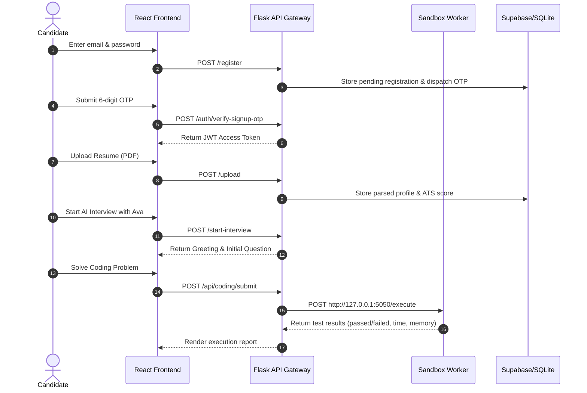

# 🧪 PrepFly Quality Assurance & Testing Guide (`TESTING.md`)

This document serves as the comprehensive Quality Assurance (QA) and Testing Guide for **PrepFly**. It establishes the testing methodology, tools, environments, test cases, and CI/CD pipelines to guarantee the reliability, security, and performance of PrepFly across its frontend, backend API gateway, isolated sandbox worker, database layer, and AI interviewer pipelines.

---

## 📑 Table of Contents

1. [Overall Testing Strategy](#1-overall-testing-strategy)
2. [Test Environments](#2-test-environments)
3. [Testing Tools & Frameworks](#3-testing-tools--frameworks)
4. [Unit Testing Guide](#4-unit-testing-guide)
5. [API Testing Guide](#5-api-testing-guide)
6. [Integration Testing](#6-integration-testing)
7. [End-to-End (E2E) Testing](#7-end-to-end-e2e-testing)
8. [UI/UX & Accessibility Checklist](#8-uiux--accessibility-checklist)
9. [Performance & Load Testing](#9-performance--load-testing)
10. [Security & Pentest Regression Testing](#10-security--pentest-regression-testing)
11. [Database Testing & Data Integrity](#11-database-testing--data-integrity)
12. [Test Data Management](#12-test-data-management)
13. [Feature-Based Test Cases](#13-feature-based-test-cases)
14. [Bug Reporting & Defect Severity](#14-bug-reporting--defect-severity)
15. [Continuous Testing in CI/CD](#15-continuous-testing-in-cicd)
16. [Running Tests Locally](#16-running-tests-locally)
17. [Test Coverage & Quality Metrics](#17-test-coverage--quality-metrics)
18. [Known Limitations & Monitoring](#18-known-limitations--monitoring)

---

## 1. Overall Testing Strategy

### 1.1 Quality Objectives
PrepFly combines real-time AI voice evaluation, financial transactions, untrusted student code execution, and multi-tenant college placement records. Our quality objectives are:
* **Zero Security Regressions**: 100% automated enforcement against known pentest vulnerabilities (master OTPs, token forgery, sandbox breakouts).
* **Deterministic Fallbacks**: Guarantee seamless candidate experience even during external AI (Gemini) or database network partitions.
* **Low Latency & High Concurrency**: Ensure API endpoints respond in <200ms (cached) and untrusted code execution finishes within 4.0s limits.

### 1.2 Testing Pyramid
```text
           ▲
          / \        E2E Tests (Playwright / User Journeys)
         /---\       10% of total test suite
        /     \      
       /-------\     Integration Tests (API Lifecycle, DB, Sandbox)
      /         \    30% of total test suite
     /-----------\   
    /             \  Unit Tests (Services, Graders, Cache, Security)
   /---------------\ 60% of total test suite
```

### 1.3 Test Execution Stages
| Lifecycle Stage | Tests Executed | Blocking Criteria |
| :--- | :--- | :--- |
| **Local Development** | Static ruff check, targeted service unit tests | Dev cannot commit failing code |
| **Pull Request (PR)** | Static analysis, Bandit security audit, full master test runner (86 tests) | PR merge blocked on any test failure |
| **Staging Deployment** | Sandbox execution matrix (Python, JS, C++, Java), integration lifecycles | Deployment aborted on failure |
| **Production Post-Deploy** | Synthetic `/health` checks, `/api/cache/stats`, sandbox `/metrics` | Alerts triggered via Sentry / Pager |

---

## 2. Test Environments

| Dimension | Local Development | Staging | Production |
| :--- | :--- | :--- | :--- |
| **Frontend URL** | `http://localhost:5173` | `https://staging-prepfly.vercel.app` | `https://prepfly.vercel.app` |
| **Backend URL** | `http://localhost:5000` | `https://prepfly-staging.up.railway.app` | `https://prepfly.up.railway.app` |
| **Sandbox Worker** | `http://127.0.0.1:5050` | Dedicated Staging Docker Container | Hardened Isolated Container VM |
| **Database** | `local_db.sqlite` (SQLite mock) | Supabase Staging Project | Supabase Managed PostgreSQL |
| **Cache Storage** | In-Memory LRU (`memory://`) | Upstash Redis (Staging) | High-Availability Redis Cluster |
| **Gemini AI** | Mocked in unit tests / dev key | Rotated Gemini Testing Key | Rotated Domain Production Keys |
| **Razorpay Mode** | Fallback test IDs (`order_test_...`) | Razorpay Test Merchant Mode | Razorpay Live Mode |

---

## 3. Testing Tools & Frameworks

### 3.1 Configured & Active in Repository
* **Python `unittest`**: Primary test runner for backend services, regression suites, and sandbox worker.
* **`ruff`**: High-performance static analysis CI guard enforcing syntax, variable definitions, and redefinitions (`F821`, `E9`, `F811`).
* **`bandit`**: Security linter detecting hardcoded passwords and insecure tokens (`B105`, `B106`).
* **Flask Test Client**: Simulates HTTP requests, session state, headers, and cookies without binding to live network sockets.
* **Mock Framework (`unittest.mock`)**: Mocking Gemini LLM invocations, Supabase table executions, and external network sockets.

### 3.2 Proposed Quality Additions *(To Be Configured)*
* **`vitest` + `@testing-library/react`**: Component unit testing for React 19 pages and hooks.
* **Playwright**: Headless browser automation testing the end-to-end student and recruiter workflows.
* **`coverage.py`**: Automated code coverage measurement and HTML report generation.

---

## 4. Unit Testing Guide

### 4.1 Service Unit Testing Architecture
Unit tests reside in [`f_backend/tests/`](file:///d:/Downloads/interviewsystem/interviewsystem/f_backend/tests) and isolate business logic from database and network layers.

### 4.2 Representative Unit Test: AI Recruiter Phase Progression
[`f_backend/tests/test_ai_service.py`](file:///d:/Downloads/interviewsystem/interviewsystem/f_backend/tests/test_ai_service.py):
```python
import unittest
from services.ai_service import get_current_stage, generate_dynamic_question

class TestAiService(unittest.TestCase):
    def test_stage_progression_logic(self):
        """Validates that question indices map to interview recruiter phases."""
        self.assertIn("Phase 1: Greeting & Icebreaker", get_current_stage(1))
        self.assertIn("Phase 2: Icebreaker & Background", get_current_stage(2))
        self.assertIn("Phase 3: Transition into Resume", get_current_stage(3))
        self.assertIn("Phase 4: Core Technical Discussion", get_current_stage(4))
        self.assertIn("Phase 5: System Trade-offs & Deep Dive", get_current_stage(5))

    def test_voice_command_repeat_question(self):
        """Voice command 'repeat' or 'pardon' must return previous question without invoking Gemini."""
        prev = "Explain database sharding vs partitioning."
        q, stage, is_deep_dive = generate_dynamic_question(
            resume_text="Backend engineer",
            previous_questions=[prev],
            question_index=3,
            last_answer="can you repeat the question"
        )
        self.assertEqual(q, prev)
        self.assertEqual(stage, "Repeat")
```

### 4.3 Mocking External Dependencies
When testing services that interact with external APIs, always patch network boundaries:
```python
from unittest.mock import patch, MagicMock

@patch("services.subscription_service.get_supabase")
def test_active_subscription_unblocked(mock_get_sb):
    mock_sb = MagicMock()
    mock_get_sb.return_value = mock_sb
    mock_sb.table().select().eq().execute.return_value = MagicMock(data=[{
        "id": "org_active_01",
        "subscription_status": "ACTIVE",
        "current_plan": "Enterprise",
        "subscription_expiry": "2027-12-31T00:00:00"
    }])
    status = get_org_subscription_status("org_active_01")
    self.assertEqual(status["subscription_status"], "ACTIVE")
    self.assertFalse(status["is_blocked"])
```

---

## 5. API Testing Guide

### 5.1 Endpoint Test Matrix
| Endpoint | Method | Expected Status | Validation Checks |
| :--- | :--- | :--- | :--- |
| `/health` | GET | `200 OK` | `{"status": "ok", "timestamp": "..."}` |
| `/api/cache/stats` | GET | `200 OK` | `{"status": "healthy", "l1_memory": {...}}` |
| `/auth/verify-signup-otp` | POST | `400 Bad Request` | Reject missing email or OTP payload |
| `/auth/verify-signup-otp` | POST | `401 Unauthorized` | Reject invalid, expired, or master OTPs (`123456`) |
| `/api/superadmin/login` | POST | `401 Unauthorized` | Reject unauthorized non-admin email or bad password |
| `/api/coding/submit` | POST | `200 OK` | Evaluates code against hidden test cases via sandbox |
| `/get-hint` | POST | `200 OK` | Returns helpful guidance with `X-Cache: HIT/MISS` headers |

### 5.2 API Status Code Standards
* **`200 OK` / `201 Created`**: Standard successful request and resource creation.
* **`304 Not Modified`**: HTTP ETag conditional match (`If-None-Match`), zero payload body returned.
* **`400 Bad Request`**: Malformed JSON, missing mandatory parameters.
* **`401 Unauthorized`**: Missing, invalid, or expired JWT token / OTP code.
* **`403 Forbidden`**: Valid token, but insufficient permissions (e.g., student calling superadmin routes).
* **`429 Too Many Requests`**: Rate limit or sandbox user quota exceeded.
* **`500 Internal Server Error`**: Unhandled backend exception (must be captured in Sentry).

---

## 6. Integration Testing

PrepFly includes dedicated end-to-end integration test suites in [`f_backend/tests/integration/`](file:///d:/Downloads/interviewsystem/interviewsystem/f_backend/tests/integration):

### 6.1 Authentication Lifecycle
[`test_auth_lifecycle.py`](file:///d:/Downloads/interviewsystem/interviewsystem/f_backend/tests/integration/test_auth_lifecycle.py):
1. **Registration**: `POST /register` creates pending account and dispatches OTP.
2. **OTP Verification**: `POST /auth/verify-signup-otp` confirms OTP and generates live JWT.
3. **Protected Access**: `GET /update-profile` verifies authorized JWT access.
4. **Relogin**: `POST /login` + `POST /auth/verify-login-otp` completes dual-step login flow.

### 6.2 Billing & Subscription Lifecycle
[`test_billing_lifecycle.py`](file:///d:/Downloads/interviewsystem/interviewsystem/f_backend/tests/integration/test_billing_lifecycle.py):
1. **Trial Auto-Creation**: Default 10-day trial created for new organization.
2. **Order Generation**: `POST /api/payment/create-order` calculates 18% GST and returns order details.
3. **Signature Verification**: Verifies HMAC-SHA256 signature and upgrades organization to 365-day plan.
4. **Invoice Rendering**: Generates official HTML invoice with branding and sequential invoice number.

### 6.3 Recruiter Interview Lifecycle
[`test_interview_lifecycle.py`](file:///d:/Downloads/interviewsystem/interviewsystem/f_backend/tests/integration/test_interview_lifecycle.py):
1. **Session Creation**: `POST /start-interview` creates session with selected difficulty.
2. **Dynamic Hints**: `POST /get-hint` returns targeted advice.
3. **Question Progression**: `POST /next` submits candidate answers and fetches next phase.
4. **Final Scoring**: `POST /end-interview` calculates 6-metric grading and issues downloadable report.

---

## 7. End-to-End (E2E) Testing

### 7.1 Major Candidate Journey


### 7.2 Proposed Playwright Workflow (*Proposed*)
```javascript
// e2e/interview_journey.spec.js (Proposed)
import { test, expect } from '@playwright/test';

test('complete student interview and coding assessment flow', async ({ page }) => {
  await page.goto('http://localhost:5173/login');
  await page.fill('input[type="email"]', 'candidate@prepfly.io');
  await page.click('button:has-text("Sign In")');
  
  // Submit OTP
  await page.fill('input[name="otp"]', '998811');
  await page.click('button:has-text("Verify")');
  await expect(page).toHaveURL(/.*dashboard/);

  // Navigate to Coding Assessment
  await page.click('text=Coding Assessment');
  await page.click('text=Solve Two Sum');
  await page.click('button:has-text("Run Code")');
  await expect(page.locator('.test-case-passed')).toBeVisible();
});
```

---

## 8. UI/UX & Accessibility Checklist

- [ ] **Cross-Browser Testing**: Verified on Chrome 120+, Firefox 122+, Safari 17+, Edge.
- [ ] **Responsive Breakpoints**:
  - Mobile (375px): Hamburger navigation, single-column dashboard cards.
  - Tablet (768px): Flexible split-screen interview panel.
  - Desktop (1280px+): Full multi-pane coding IDE and live interview stream.
- [ ] **Form Validation**: Immediate inline feedback on invalid email formats or short passwords.
- [ ] **State Handling**:
  - Loading State: Skeleton loaders and spinner indicators during AI generation.
  - Empty State: Helpful guidance when no previous interview recordings exist.
  - Error State: User-friendly banners on network loss with retry buttons.
- [ ] **Accessibility (WCAG 2.1 AA)**:
  - Color contrast ratio ≥ 4.5:1 for normal text.
  - Full keyboard navigability (Tab, Enter, Escape modal closing).
  - Proper ARIA labels on audio recording and mic toggle buttons.

---

## 9. Performance & Load Testing

### 9.1 Performance Indicators & Targets
| Metric | Measured Baseline | Target SLA | Strategy to Achieve Target |
| :--- | :--- | :--- | :--- |
| **Cached API Response** | `1.2ms` | `< 50ms` | L1 In-Memory LRU Cache |
| **Uncached DB Query** | `12ms – 35ms` | `< 100ms` | B-tree indexing on foreign keys |
| **Code Sandbox Execution** | `42ms` (simple Python) | `< 500ms` | Pre-warmed sandbox worker threads |
| **AI Dynamic Hint** | `0.2ms` (cached) / `2.1s` (LLM) | `< 2.5s` | SHA-256 prompt-response caching |
| **Full Suite Execution** | `32.9s` (86 tests) | `< 45.0s` | Parallelized in-memory SQLite runner |

### 9.2 Proposed Locust Load Test (*Proposed*)
```python
# load_tests/locustfile.py (Proposed)
from locust import HttpUser, task, between

class PrepFlyCandidateUser(HttpUser):
    wait_time = between(1, 3)

    @task(3)
    def fetch_health_and_stats(self):
        self.client.get("/health")
        self.client.get("/api/cache/stats")

    @task(1)
    def submit_code(self):
        self.client.post("/api/coding/submit", json={
            "language": "python",
            "code": "print('speed-test')",
            "problem_id": "test-1"
        })
```

---

## 10. Security & Pentest Regression Testing

PrepFly maintains an automated security regression test suite in [`f_backend/tests/test_security_regressions.py`](file:///d:/Downloads/interviewsystem/interviewsystem/f_backend/tests/test_security_regressions.py) verifying confirmed pentest findings #1 to #11:

### 10.1 Verified Security Regressions Matrix
| Test Method | Pentest Finding Verified | Expected Security Behavior |
| :--- | :--- | :--- |
| `test_01_master_otps_rejected` | Finding #1: Master OTP Backdoor | Hardcoded OTPs (`123456`, `981103`) rejected with 401 across all auth flows. |
| `test_02_superadmin_wrong_password` | Finding #2: Superadmin Auth Bypass | Wrong password returns 401 even when user has no DB row. |
| `test_03_weak_jwt_keys_rejected` | Finding #3: Hardcoded JWT Secrets | Tokens signed with default keys (`super-secret-key-123`) rejected with 401. |
| `test_04_session_student_isolation` | Finding #4: IDOR in Interview Sessions | Student A cannot view or delete Student B's interview recordings. |
| `test_05_role_tampering_blocked` | Finding #5: Privilege Escalation | Signup payload with `role: "admin"` forced to `role: "student"`. |
| `test_06_sql_injection_defense` | Finding #6: Dynamic SQL Injection | Column and table identifier validation rejects `'; DROP TABLE;`. |
| `test_07_rate_limiter_active` | Finding #7: Brute Force Attacks | Rapid OTP requests trigger HTTP 429 Too Many Requests. |
| `test_08_open_redirect_defense` | Finding #8: OAuth Open Redirect | OAuth redirect target constrained strictly to configured whitelist. |

### 10.2 Sandbox Jailbreak & Malicious Code Neutralization
Tested in [`sandbox_worker/tests/test_malicious_code.py`](file:///d:/Downloads/interviewsystem/interviewsystem/sandbox_worker/tests/test_malicious_code.py):
* **Fork Bombs (`:(){ :|:& };:`)**: Neutralized by max 16 PID process cap (`RLIMIT_NPROC`).
* **Infinite Loops (`while True: pass`)**: Terminated at 4.0s wall clock limit via process group `SIGKILL`.
* **Memory Exhaustion (`"a" * 10**9`)**: Blocked by 128 MB RAM cap (`RLIMIT_AS`).
* **Filesystem Tampering**: Blocked by read-only root mount and non-root execution (`UID 10001`).
* **Network Sockets**: Outbound sockets blocked by Docker network isolation.

---

## 11. Database Testing & Data Integrity

### 11.1 Test Fixture Setup
* During test execution, `local_supabase.py` intercepts Supabase calls and routes them to an isolated in-memory or temporary SQLite database (`local_db.sqlite`).
* Tests execute within isolated transactions or unique tenant prefixes (`org_test_...`, `user_test_...`) to prevent state leakage.

### 11.2 Validating Constraints & Foreign Keys
```sql
-- Ensure orphaned sessions cannot exist
SELECT sessions.session_id FROM sessions 
LEFT JOIN users ON sessions.user_id = users.id 
WHERE users.id IS NULL;
-- (Must return 0 rows)
```

---

## 12. Test Data Management

* **Deterministic Mock Data**: Use fixed timestamps and repeatable test identifiers (`test_user_01`, `org_test_college`).
* **Never Use Real User Data**: Test suites must never load actual student resumes, personal emails, or real payment IDs.
* **Cleanup Hooks**: Use `tearDown()` or context managers to delete generated test records:
  ```python
  def tearDown(self):
      self.supabase.table("users").delete().eq("email", "temp_test@prepfly.io").execute()
  ```

---

## 13. Feature-Based Test Cases

| Test ID | Feature | Prerequisites | Steps | Expected Result | Priority |
| :--- | :--- | :--- | :--- | :--- | :--- |
| **TC-AUTH-01** | Student Signup | Valid Email | Submit registration form | OTP sent, user in `pending_users` | **P0** |
| **TC-AUTH-02** | Master OTP Block | Valid Registration | Submit OTP `123456` | HTTP 401 Unauthorized | **P0** |
| **TC-INT-01** | Start AI Interview | Logged in Student | POST `/start-interview` | Returns `session_id`, Phase 1 question | **P0** |
| **TC-INT-02** | Repeat Command | Active Interview | Submit answer "repeat" | Returns previous question, Phase "Repeat" | **P1** |
| **TC-INT-03** | Cached AI Hint | Active Interview | POST `/get-hint` twice | Second call returns in <1ms with `X-Cache: HIT` | **P1** |
| **TC-COD-01** | Python Solution | Active Problem | Submit valid Two Sum code | All test cases pass, time < 100ms | **P0** |
| **TC-COD-02** | Sandbox Timeout | Active Problem | Submit infinite loop code | Terminated with status "timeout" at 4.0s | **P0** |
| **TC-RES-01** | Resume Parsing | Valid PDF | POST `/upload` with sample.pdf | Returns ATS score, extracted skills, JSON data | **P0** |
| **TC-SUB-01** | 10-Day Auto Trial | New College Org | Create organization | Status is `TRIAL`, 10 days remaining | **P1** |
| **TC-SUB-02** | Expired Block | Expired Org | Student attempts interview | Access blocked with renewal reminder | **P0** |

---

## 14. Bug Reporting & Defect Severity

### 14.1 Defect Severity Levels
* **Critical (S1)**: Complete service outage, authentication bypass, data leak, code sandbox jailbreak.
* **High (S2)**: Core feature broken (e.g., student unable to submit interview answer, payment failure).
* **Medium (S3)**: Non-critical feature bug (e.g., UI formatting flaw, delay in PDF report generation).
* **Low (S4)**: Minor cosmetic issue, typo, minor layout misalignment.

### 14.2 Bug Report Template
```markdown
### Bug Title: [Brief descriptive summary]

**Environment**: Local / Staging / Production
**Severity**: S1 - Critical / S2 - High / S3 - Medium / S4 - Low
**Component**: Frontend / Gateway API / Sandbox / Database / AI Engine

#### Steps to Reproduce:
1. Navigate to '...'
2. Enter payload: `{ ... }`
3. Click 'Submit'

#### Expected Result:
HTTP 200 OK with expected JSON structure.

#### Actual Result:
HTTP 500 Internal Server Error / Uncaught Exception.

#### Supporting Evidence:
- Relevant log snippet from `stdout` or `sandbox_audit.log`
- Request ID or cURL command
```

---

## 15. Continuous Testing in CI/CD

PrepFly runs automated CI guards on every pull request and push to `main`, `master`, or `develop` via [`.github/workflows/ci.yml`](file:///d:/Downloads/interviewsystem/interviewsystem/.github/workflows/ci.yml):

```yaml
name: PrepFly CI

on:
  push:
    branches: [ "main", "master", "develop" ]
  pull_request:
    branches: [ "main", "master", "develop" ]

jobs:
  backend-checks:
    name: Backend Security, Lint, & Test Suite
    runs-on: ubuntu-latest

    steps:
    - uses: actions/checkout@v4
    - uses: actions/setup-python@v5
      with:
        python-version: '3.11'

    - name: Install Dependencies
      run: |
        pip install -r f_backend/requirements.txt ruff bandit

    - name: Static Analysis CI Guard
      run: ruff check . --select F821,E9,F811

    - name: Bandit Security Scan
      run: cd f_backend && python -m bandit -r . -x ./venv,./tests -t B105,B106

    - name: Run Master Test Suite
      env:
        FLASK_ENV: test
        JWT_SECRET_KEY: test-secret-key-32-chars-long-for-testing-only-12345
        SUPABASE_URL: https://test-project.supabase.co
        SUPABASE_SERVICE_KEY: test-service-key-for-unit-testing
        GEMINI_API_KEY: test-gemini-key
        RAZORPAY_KEY_ID: rzp_test_dummy_id
        RAZORPAY_KEY_SECRET: test_razorpay_secret_for_testing
      run: |
        cd f_backend
        python run_all_tests.py
```

---

## 16. Running Tests Locally

### 16.1 Backend Master Test Runner (86 Tests)
Runs static integrity analysis followed by discovery of all unit and integration tests:
```powershell
cd f_backend
.\venv\Scripts\python.exe run_all_tests.py
```
*Expected Result*:
```text
===========================================================================
                        COMPLETE TEST SUITE SUMMARY
===========================================================================
Total Tests Executed: 86
Passed:               86
Failures:             0
Errors:               0
===========================================================================
>>> ALL PREPFLY UNIT & INTEGRATION TESTS PASSED WITH 100% SUCCESS! <<<
```

### 16.2 Running Individual Test Suites
* **Security Regressions**:
  ```powershell
  cd f_backend
  .\venv\Scripts\python.exe -m unittest tests/test_security_regressions.py
  ```
* **Multi-Tier Cache Engine**:
  ```powershell
  cd f_backend
  .\venv\Scripts\python.exe -m unittest tests/test_cache_service.py
  ```
* **AI Recruiter Service**:
  ```powershell
  cd f_backend
  .\venv\Scripts\python.exe -m unittest tests/test_ai_service.py
  ```
* **Sandbox Worker Isolation & Malicious Code (27 Tests)**:
  ```powershell
  cd sandbox_worker
  python -m unittest discover tests
  ```

---

## 17. Test Coverage & Quality Metrics

### 17.1 Code Coverage Target Goals
| Module | Target Line Coverage | Target Branch Coverage |
| :--- | :--- | :--- |
| **Authentication & Tokens** (`app.py`, `auth`) | `> 90%` | `> 85%` |
| **Billing & Payments** (`payment_service.py`) | `> 90%` | `> 85%` |
| **Sandbox Security** (`runner.py`, `security.py`) | `> 95%` | `> 90%` |
| **AI Fallback & Stages** (`ai_service.py`) | `> 85%` | `> 80%` |
| **Overall Platform Average** | `> 80%` | `> 75%` |

### 17.2 Measuring Coverage with `coverage.py`
```powershell
cd f_backend
coverage run --source=services,app run_all_tests.py
coverage report -m
coverage html  # Generates detailed HTML report in htmlcov/index.html
```

---

## 18. Known Limitations & Monitoring

### 18.1 Testing Boundaries & Known Limitations
1. **Physical Webcam / Microphone**: Browser speech-to-text and live video feeds cannot be fully stimulated in headless unit test runners. Testing relies on synthetic audio byte stream fixtures (`uploads/speech.mp3`).
2. **Third-Party Rate Limits**: Live Google Gemini calls are mocked in automated CI to avoid exhausting API quotas or incurring inference billing.
3. **P2P WebRTC Signaling**: Peer-to-peer live mock interviews require STUN/TURN traversal testing on real networks.

### 18.2 Production Error & Telemetry Monitoring
* **Sentry Exception Tracking**: Integrated in `f_backend/app.py` for real-time unhandled error capture.
* **Audit Trail**: Every executed sandbox submission is permanently recorded in `sandbox_audit.log` for forensic analysis.
* **Cache Health**: Monitored continuously via `GET /api/cache/stats`.
