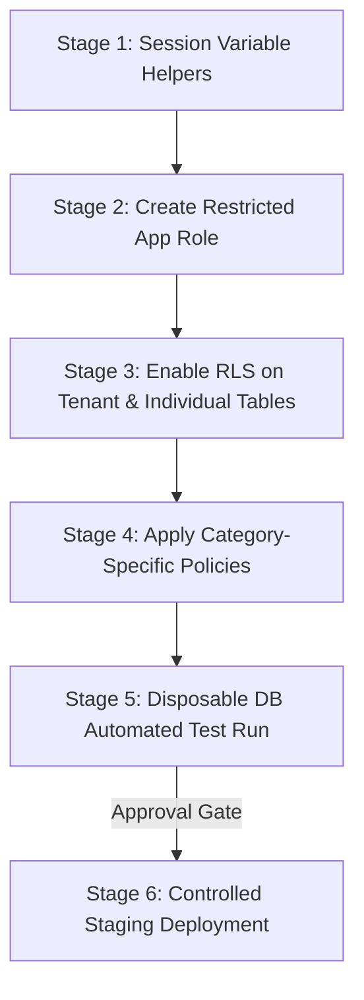

# PREPFLY: SUPABASE RLS HARDENING MIGRATION PLAN
## Reversible Staged Rollout Strategy & Disposable DB Verification

**Date:** November 17, 2026  
**Auditor:** Senior Full-Stack & Security Engineer (Antigravity)  
**Status:** **PROPOSED BLUEPRINT (NO PRODUCTION EXECUTION UNTIL APPROVED)**  

---

## 1. Rollout Principles & Safety Gates

1. **Zero Downtime:** Existing Flask queries must continue operating without interruption.
2. **Never Execute on Production Directly:** All migration scripts must first run and pass against a disposable staging database.
3. **Idempotence & Reversibility:** Every forward statement has an exact down counterpart in the rollback script.
4. **Fail-Closed Permissions:** Default privileges for `anon` must be explicitly revoked.

---

## 2. Staged Migration Strategy



### Stage 1: Deploy Session Context Functions
- Installs `current_app_user_id()`, `current_app_user_role()`, and `current_app_org_id()`.
- Purely additive SQL functions. Zero impact on existing queries.

### Stage 2: Create Restricted Database Role
- Creates `prepfly_app_role` with `NOBYPASSRLS`.
- Grants `SELECT, INSERT, UPDATE, DELETE` on `public` schema.
- Revokes permissions from `anon`.

### Stage 3: Enable RLS Across All 111 Tables
- Executes `ALTER TABLE <table_name> ENABLE ROW LEVEL SECURITY;` on all 83 unmanaged tables.
- Applies `FORCE ROW LEVEL SECURITY` to prevent bypass.

### Stage 4: Apply Categorized RLS Policies
- **GLOBAL:** `FOR SELECT TO prepfly_app_role USING (true)`
- **TENANT_OWNED:** `organization_id = current_app_org_id()`
- **INDIVIDUAL_OWNED:** `user_id = current_app_user_id()`
- **SHARED:** Dual policy allowing student access or matching tenant access.
- **SENSITIVE:** Restricted to `service_role`.

---

## 3. Forward Migration Script Draft (`017_comprehensive_rls_hardening.sql`)

```sql
-- Migration 017: Comprehensive Row Level Security & Restricted App Role Hardening
-- PrepFly Production Database Security Enhancement

BEGIN;

-- 1. Create Session Context Extraction Helpers
CREATE OR REPLACE FUNCTION public.current_app_user_id() RETURNS TEXT AS $$
    SELECT NULLIF(current_setting('app.current_user_id', true), '');
$$ LANGUAGE sql STABLE;

CREATE OR REPLACE FUNCTION public.current_app_user_role() RETURNS TEXT AS $$
    SELECT NULLIF(current_setting('app.current_user_role', true), '');
$$ LANGUAGE sql STABLE;

CREATE OR REPLACE FUNCTION public.current_app_org_id() RETURNS TEXT AS $$
    SELECT NULLIF(current_setting('app.current_org_id', true), '');
$$ LANGUAGE sql STABLE;

-- 2. Revoke Dangerous Default Public PostgREST Permissions
REVOKE ALL ON ALL TABLES IN SCHEMA public FROM anon;
REVOKE ALL ON ALL SEQUENCES IN SCHEMA public FROM anon;

-- 3. Ensure Service Role Retains Administrative Access on All Tables
DO $$
DECLARE
    t text;
BEGIN
    FOR t IN 
        SELECT table_name FROM information_schema.tables WHERE table_schema = 'public' AND table_type = 'BASE TABLE'
    LOOP
        EXECUTE format('ALTER TABLE public.%I ENABLE ROW LEVEL SECURITY;', t);
        EXECUTE format('DROP POLICY IF EXISTS "service_role_all_%I" ON public.%I;', t, t);
        EXECUTE format('CREATE POLICY "service_role_all_%I" ON public.%I FOR ALL TO service_role USING (true) WITH CHECK (true);', t, t);
    END LOOP;
END $$;

-- 4. Apply Tenant-Owned Policies for Application Role
CREATE POLICY "tenant_isolation_org_memberships" ON public.org_memberships
    FOR ALL TO prepfly_app_role
    USING (organization_id = public.current_app_org_id())
    WITH CHECK (organization_id = public.current_app_org_id());

CREATE POLICY "tenant_isolation_admin_interviews" ON public.admin_interviews
    FOR ALL TO prepfly_app_role
    USING (organization_id = public.current_app_org_id())
    WITH CHECK (organization_id = public.current_app_org_id());

CREATE POLICY "tenant_isolation_admin_coding" ON public.admin_coding
    FOR ALL TO prepfly_app_role
    USING (organization_id = public.current_app_org_id() OR organization_id = 'global')
    WITH CHECK (organization_id = public.current_app_org_id());

CREATE POLICY "tenant_isolation_announcements" ON public.announcements
    FOR ALL TO prepfly_app_role
    USING (organization_id = public.current_app_org_id())
    WITH CHECK (organization_id = public.current_app_org_id());

-- 5. Apply Individual-Owned Policies (Student Privacy)
CREATE POLICY "individual_isolation_parsed_resumes" ON public.parsed_resumes
    FOR ALL TO prepfly_app_role
    USING (public.current_app_user_role() = 'candidate' AND user_id = public.current_app_user_id())
    WITH CHECK (public.current_app_user_role() = 'candidate' AND user_id = public.current_app_user_id());

CREATE POLICY "individual_isolation_mentor_conversations" ON public.mentor_conversations
    FOR ALL TO prepfly_app_role
    USING (public.current_app_user_role() = 'candidate' AND user_id = public.current_app_user_id())
    WITH CHECK (public.current_app_user_role() = 'candidate' AND user_id = public.current_app_user_id());

-- 6. Apply Shared Dual-Context Policies
CREATE POLICY "shared_sessions_access" ON public.sessions
    FOR ALL TO prepfly_app_role
    USING (
        (public.current_app_user_role() = 'candidate' AND user_id = public.current_app_user_id())
        OR
        (public.current_app_user_role() IN ('admin', 'org_admin') AND organization_id IS NOT NULL AND organization_id = public.current_app_org_id())
    );

COMMIT;

-- Reload schema notification for PostgREST
NOTIFY pgrst, 'reload schema';
```

---

## 4. Rollback Script Draft (`017_comprehensive_rls_hardening_rollback.sql`)

```sql
-- Rollback for Migration 017: Revert RLS and Helper Policies
BEGIN;

-- 1. Drop Application RLS Policies
DROP POLICY IF EXISTS "tenant_isolation_org_memberships" ON public.org_memberships;
DROP POLICY IF EXISTS "tenant_isolation_admin_interviews" ON public.admin_interviews;
DROP POLICY IF EXISTS "tenant_isolation_admin_coding" ON public.admin_coding;
DROP POLICY IF EXISTS "tenant_isolation_announcements" ON public.announcements;
DROP POLICY IF EXISTS "individual_isolation_parsed_resumes" ON public.parsed_resumes;
DROP POLICY IF EXISTS "individual_isolation_mentor_conversations" ON public.mentor_conversations;
DROP POLICY IF EXISTS "shared_sessions_access" ON public.sessions;

-- 2. Drop Session Context Functions
DROP FUNCTION IF EXISTS public.current_app_user_id();
DROP FUNCTION IF EXISTS public.current_app_user_role();
DROP FUNCTION IF EXISTS public.current_app_org_id();

COMMIT;

-- Reload schema notification for PostgREST
NOTIFY pgrst, 'reload schema';
```

---

## 5. Disposable Database Verification Strategy

Before applying any SQL to the live Supabase project:
1. Spin up a temporary local PostgreSQL 16 container (`docker run --name prepfly-pg-audit -p 5433:5432 -e POSTGRES_PASSWORD=audit_pass -d postgres:16`).
2. Run migrations `001` through `016` to establish baseline schema.
3. Apply `017_comprehensive_rls_hardening.sql`.
4. Execute SQL assertions verifying:
   - Queries under `prepfly_app_role` without setting `app.current_org_id` return 0 rows.
   - College A cannot read College B student records.
   - College A cannot read candidate private resumes.
   - `service_role` continues to read and write without error.
5. Apply `017_..._rollback.sql` and verify clean restoration.
