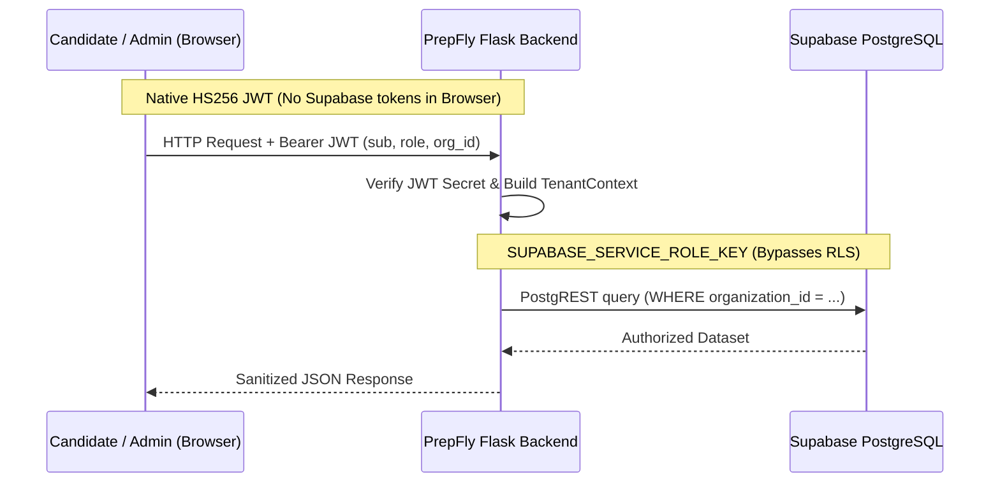

# PREPFLY: SUPABASE SECURITY AUDIT (PHASE 0)
## Comprehensive Database Architecture, RLS, Access Controls & Security Invariants

**Date:** November 17, 2026  
**Auditor:** Senior Full-Stack & Security Engineer (Antigravity)  
**Status:** **PHASE 0 READ-ONLY AUDIT (NO PRODUCTION CHANGES APPLIED)**  
**Target Repository:** `D:\Downloads\interviewsystem\interviewsystem`  
**Current Branch:** `ai-inw`  

---

## 1. Executive Summary

This Phase 0 security audit inspects the Supabase PostgreSQL database architecture powering PrepFly. It documents every table, column, relationship, constraint, Row-Level Security (RLS) configuration, API key usage pattern, storage state, and backup mechanism across the repository.

### Key Audit Findings:
1. **Frontend Isolation (SAFE):** Zero direct frontend access to Supabase. `f_frontend` has no `@supabase/supabase-js` dependency, no `VITE_SUPABASE_ANON_KEY`, and routes 100% of user traffic through the Flask API layer.
2. **Backend Service-Role Dominance (CRITICAL ARCHITECTURAL CONTEXT):** Flask initializes a single global Supabase client using `SUPABASE_SERVICE_ROLE_KEY`. Consequently, **all backend queries bypass PostgreSQL Row-Level Security (RLS) entirely**. Route guards and server-side tenancy enforcement (`services/tenancy.py`) currently serve as the primary defensive barrier.
3. **Severe RLS Coverage Gap (HIGH RISK IF ANON KEY EXPOSED):** Out of 111 tables across the platform, only **28 tables have RLS enabled** in migrations. **83 tables have RLS disabled or missing entirely**, including `users` (credentials & PII), `organization`, `admin`, `parsed_resumes`, `coding_submissions`, and `audit_logs`. If the Supabase REST endpoint (`PostgREST`) is reached with an `anon` key, unmanaged tables are completely exposed.
4. **Storage Buckets (NOT IN USE):** PrepFly currently persists files (resumes, audio/video, sheets, feedback screenshots) on the server filesystem (`f_backend/uploads`). No Supabase Storage buckets are provisioned or in active use.
5. **Database Functions & Triggers (CLEAN):** No dangerous un-sandboxed `SECURITY DEFINER` functions exist. Minimal triggers exist solely for `updated_at` timestamps.

---

## 2. Supabase Project Configuration & PostgreSQL Details

| Parameter | Configuration Value | Security Assessment |
|---|---|---|
| **Project URL** | `https://liquygzrammcbsikirae.supabase.co` | Standard managed Supabase Cloud project endpoint |
| **Hosting Region** | Managed Supabase AWS Infrastructure | TLS 1.3 enforced on HTTPS REST and WebSocket gateways |
| **PostgreSQL Version** | PostgreSQL 15.x / 16.x (Managed Supabase Postgres) | Up-to-date relational engine with native JSONB, RLS, and cryptographic extensions (`pgcrypto`) |
| **API Interface** | PostgREST (auto-generated REST API over `/rest/v1/`) | Auto-exposes public schema tables unless explicitly secured via RLS or schema revokes |
| **Local Mock Engine** | `local_supabase.py` (SQLite fallback mock) | Provides offline parity with 111 table schemas for isolated testing |

---

## 3. Table Inventory & Row-Level Security (RLS) Status

A complete inventory of all 111 tables in the PrepFly architecture, classified by domain and current RLS status in PostgreSQL migrations:

### 3.1 Authentication, Identity & Tenancy (8 Tables)
| Table Name | Purpose | Migration | Current RLS Status | Risk Level |
|---|---|---|---|---|
| `users` | Primary student & candidate accounts, hashes, PII | Legacy / 007 | **DISABLED / MISSING** | **CRITICAL** |
| `organization` | Institutions, seat limits, join codes | Legacy / 016 | **DISABLED / MISSING** | **HIGH** |
| `org_memberships` | Student institutional linkages, roll numbers | 016 | **ENABLED** | Controlled |
| `org_invites` | Campus join tokens and expiration | 016 | **ENABLED** | Controlled |
| `admin` | College organization admin credentials | Legacy / 011 | **DISABLED / MISSING** | **CRITICAL** |
| `super_admin` | Platform owner credentials & permissions | Legacy / 015 | **DISABLED / MISSING** | **CRITICAL** |
| `pending_users` | Unverified registrations awaiting OTP | Legacy | **DISABLED / MISSING** | **MEDIUM** |
| `otps` / `otp_requests` | Short-lived 6-digit verification codes | Legacy | **DISABLED / MISSING** | **HIGH** |

### 3.2 Candidate Resumes, Documents & PII (4 Tables)
| Table Name | Purpose | Migration | Current RLS Status | Risk Level |
|---|---|---|---|---|
| `parsed_resumes` | Extracted resume plain text, ATS scores, skills | 007 | **DISABLED / MISSING** | **CRITICAL** |
| `candidate_resume_claims` | Extracted factual claims from candidate resume | 002 | **ENABLED** | Controlled |
| `candidate_profiles` | Candidate target preferences and metadata | 001 | **ENABLED** | Controlled |
| `resume_scores` | Scored dimensions and recruiter feedback | Legacy | **DISABLED / MISSING** | **HIGH** |

### 3.3 AI Interview Engine & Voice Sessions (11 Tables)
| Table Name | Purpose | Migration | Current RLS Status | Risk Level |
|---|---|---|---|---|
| `sessions` | Interview sessions, status, target roles | 010 | **ENABLED** | Controlled |
| `interview_turns` | Transcribed speech and typed candidate answers | 002 / 010 / 012 | **ENABLED** | Controlled |
| `interview_speech_metrics` | WPM, latency, filler words, audio metrics | 010 | **ENABLED** | Controlled |
| `interview_evaluations` | AI rubric evaluation per interview turn | 010 | **ENABLED** | Controlled |
| `interview_reports` | Final interview report, scores, evidence quotes | 010 | **ENABLED** | Controlled |
| `interview_question_rubrics` | Evaluation rubrics (service-role only) | 010 | **ENABLED** | Controlled |
| `interviewer_profiles` | Persona configurations (Ava, tone, formality) | 002 | **ENABLED** | Controlled |
| `interview_goals` | Adaptive candidate targets and weak spots | 009 | **ENABLED** | Controlled |
| `speech_analyses` | Legacy acoustic speech features | 007 | **DISABLED / MISSING** | **MEDIUM** |
| `admin_interviews` | Institutional interview templates | Legacy | **DISABLED / MISSING** | **HIGH** |
| `webrtc_rooms` | Ephemeral video/audio signaling rooms | Legacy | **DISABLED / MISSING** | **MEDIUM** |

### 3.4 Diagnostic, Scoring & Skill Taxonomy (17 Tables)
| Table Name | Purpose | Migration | Current RLS Status | Risk Level |
|---|---|---|---|---|
| `skills` / `canonical_skills` | Taxonomy of evaluated skills and tools | 001 / 006 | **ENABLED** (partial) | Low |
| `subskills` / `skill_prerequisites` | Dependency graphs and prerequisite trees | 001 / 013 | **ENABLED** (partial) | Low |
| `candidate_skill_profiles` | Live proficiency and confidence ratings | 001 | **ENABLED** | Controlled |
| `candidate_skill_states` | Evidence-based Bayesian skill proficiency | 008 | **ENABLED** | Controlled |
| `skill_evidence` | Raw evaluation evidence tying turns to skills | 001 / 008 | **ENABLED** | Controlled |
| `skill_evidence_registry` | Immutable evidence ledger | 006 | **DISABLED / MISSING** | **HIGH** |
| `readiness_snapshots` | Point-in-time readiness calculations | 004 | **DISABLED / MISSING** | **HIGH** |
| `score_audit_log` | Mathematical trail of all score updates | 008 | **ENABLED** | Controlled |
| `assessment_items` | Curated diagnostic questions & answers | 008 | **ENABLED** | Controlled |
| `evaluations` | Raw diagnostic question evaluations | 008 | **ENABLED** | Controlled |
| `career_goals` | Candidate career goals and target timeline | 008 | **ENABLED** | Controlled |
| `job_skill_requirements` | Extracted requirements per target JD | 008 | **ENABLED** | Controlled |
| `pillars` / `skill_snapshots` | Section 5 scoring pillars and snapshots | 013 | **DISABLED / MISSING** | **MEDIUM** |
| `candidate_intelligence_snapshots`| Comprehensive intelligence states | 005 | **DISABLED / MISSING** | **HIGH** |

### 3.5 Preparation Roadmaps, Planning & Mentorship (18 Tables)
| Table Name | Purpose | Migration | Current RLS Status | Risk Level |
|---|---|---|---|---|
| `plans` / `roadmaps` | Generated structured preparation roadmaps | 001 / 013 | **ENABLED** (partial) | Controlled |
| `plan_days` / `roadmap_versions` | Phased preparation schedule by calendar date | 001 / 013 | **ENABLED** (partial) | Controlled |
| `plan_blocks` / `roadmap_activities`| Granular 15m/30m/45m study activities | 001 / 013 | **ENABLED** | Controlled |
| `activity_attempts` | Candidate completions of study blocks | 001 | **ENABLED** | Controlled |
| `study_logs` | Verified study minutes and session logs | 013 | **DISABLED / MISSING** | **MEDIUM** |
| `availability` / `blackout_dates` | Candidate schedule constraints | 013 | **DISABLED / MISSING** | **MEDIUM** |
| `revision_schedules` | Spaced repetition intervals and drills | 001 | **ENABLED** | Controlled |
| `mentor_conversations` | Persistent AI Mentor chat threads | Legacy / 013 | **DISABLED / MISSING** | **HIGH** |
| `mentor_messages` | Full conversation transcripts with AI Mentor | Legacy / 013 | **DISABLED / MISSING** | **HIGH** |
| `chat_messages` | In-app candidate communications | 013 | **DISABLED / MISSING** | **HIGH** |

### 3.6 Coding Environment & Question Bank (7 Tables)
| Table Name | Purpose | Migration | Current RLS Status | Risk Level |
|---|---|---|---|---|
| `coding_problems` / `admin_coding` | Coding problem repository | Legacy | **DISABLED / MISSING** | **MEDIUM** |
| `coding_submissions` | Candidate source code, runtime, test outputs | 007 | **DISABLED / MISSING** | **CRITICAL** |
| `coding_rooms` | Collaborative coding live sessions | Legacy | **DISABLED / MISSING** | **MEDIUM** |
| `question_bank` | Curated institutional and global questions | Legacy | **DISABLED / MISSING** | **HIGH** |
| `question_sheets` | Uploaded institutional problem sheets | Legacy | **DISABLED / MISSING** | **HIGH** |

### 3.7 Subscriptions, Financials & API Limits (6 Tables)
| Table Name | Purpose | Migration | Current RLS Status | Risk Level |
|---|---|---|---|---|
| `subscription` / `platform_plans` | Active institutional and candidate plans | Legacy | **DISABLED / MISSING** | **CRITICAL** |
| `payment` | Captured Razorpay transactions and orders | 011 | **ENABLED** | Controlled |
| `invoice` | Generated billing statements and receipts | 011 | **ENABLED** | Controlled |
| `user_api_spending_limits` | Monthly budget ceilings in USD / paise | 014 | **DISABLED / MISSING** | **HIGH** |
| `user_api_usage` | Token counts and per-feature API costs | 014 | **DISABLED / MISSING** | **HIGH** |

### 3.8 Support, Notifications, Feedback & Audit (9 Tables)
| Table Name | Purpose | Migration | Current RLS Status | Risk Level |
|---|---|---|---|---|
| `notifications` | In-app alerts, broadcasts, reminders | 011 | **ENABLED** | Controlled |
| `support_conversations` | Institutional support tickets | Legacy | **DISABLED / MISSING** | **HIGH** |
| `support_messages` | Support ticket message transcripts | Legacy | **DISABLED / MISSING** | **HIGH** |
| `feedback` / `student_feedbacks` | Candidate platform ratings & surveys | Legacy | **DISABLED / MISSING** | **MEDIUM** |
| `activity_logs` | Legacy action logging | 010 | **DISABLED / MISSING** | **MEDIUM** |
| `audit_logs` | Super Admin security audit trail | 015 | **DISABLED / MISSING** | **HIGH** |
| `platform_settings` | Global configuration and feature flags | Legacy | **DISABLED / MISSING** | **HIGH** |
| `ai_configuration` | Model routing and temperature settings | Legacy | **DISABLED / MISSING** | **HIGH** |

---

## 4. Existing RLS Policies & Actual Runtime Behavior

### 4.1 Policy Audit
The migrations currently define **30 RLS policies** across enabled tables. Representative policies:
- **`sessions`**:
  - `candidate_select_own_sessions`: `USING (auth.uid() = user_id)`
  - `service_role_all_sessions`: `FOR ALL TO service_role USING (true) WITH CHECK (true)`
- **`interview_turns`**:
  - `candidate_select_own_turns`: `USING (EXISTS (SELECT 1 FROM sessions WHERE sessions.id = interview_turns.session_id AND sessions.user_id = auth.uid()))`
  - `service_role_all_interview_turns`: `FOR ALL TO service_role USING (true) WITH CHECK (true)`
- **`notifications`**:
  - `authenticated_read_scoped_notifications`: `FOR SELECT USING (auth.uid() = user_id OR organization_id IN (...))`
  - `service_role_all_notifications`: `FOR ALL TO service_role USING (true) WITH CHECK (true)`
- **`payment` & `invoice`**:
  - Restricted strictly to `service_role`: `FOR ALL TO service_role USING (true) WITH CHECK (true)`

### 4.2 Actual Runtime Behavior & Disconnect
1. **The Backend Bypass:** In `f_backend/app.py`, the Supabase client is initialized with `SUPABASE_SERVICE_ROLE_KEY`. Under PostgreSQL rules, the `service_role` superuser automatically **bypasses all RLS policies**.
2. **`auth.uid()` Nullity:** Because PrepFly issues its own self-signed HS256 JWT tokens with custom claims (`sub`, `role`, `organization_id`) rather than executing Supabase GoTrue Auth on the frontend, the PostgreSQL session variable `auth.uid()` evaluates to `NULL` for any direct REST request unless mapped.
3. **Defense-in-Depth Assessment:** Tenancy isolation and student privacy are currently enforced **strictly at the application tier** (`TenantContext` and `@require_org_admin` in `f_backend/services/tenancy.py`). Database-level RLS acts as a partial secondary shield for 28 tables, but leaves 83 tables completely unprotected at the database layer.

---

## 5. Key Management & Client Authentication Flow



- **Frontend Supabase Key:** **NONE**. Neither `anon` nor `service_role` keys are exposed in the frontend bundle.
- **Backend Service-Role Key:** Stored securely in backend environment variables (`SUPABASE_SERVICE_KEY`). Never leaked or returned in client payloads.
- **Normal Request Execution:** Flask executes queries using the service-role client, adding explicit `WHERE organization_id = org_id` or `WHERE user_id = sub` clauses at the application level.

---

## 6. Storage Buckets, Triggers, Functions & Indexes

### 6.1 Supabase Storage Buckets
- **Active Buckets:** **ZERO (0)**.
- **Current File Handling:** All file processing (resumes, audio recordings, feedback screenshots, problem sheets) saves to local server disk storage in `f_backend/uploads/` via `werkzeug.utils.secure_filename`.
- **Recommendation:** If Supabase Storage is ever adopted in the future, buckets must be configured as `public = false` with signed URL tokens (`createSignedUrl`) and explicit `storage.objects` RLS policies.

### 6.2 Database Triggers & Functions
- **Triggers:** Minimal triggers exist (e.g. `update_updated_at_column()` on `sessions` and `users`).
- **Security-Definer Functions:** None exist in application migrations. There are no vulnerable `SECURITY DEFINER` procedures with missing `search_path` parameters.

### 6.3 Existing Indexes & Foreign Keys
- **Total Composite Indexes:** **106+** created across migrations 001–016.
- **Critical Composite Indexes Verified:**
  - `idx_sessions_user_status` ON `sessions(user_id, status)`
  - `idx_interview_turns_session_turn` ON `interview_turns(session_id, turn_number)`
  - `idx_org_memberships_tenant_user` ON `org_memberships(organization_id, user_id)`
  - `idx_payment_user_created` ON `payment(user_id, created_at)`
  - `idx_audit_logs_actor_org` ON `audit_logs(actor_id, organization_id, created_at)`
- **Foreign Key Constraints:** Foreign keys exist between `org_memberships` and `organization`/`users`, `sessions` and `users`, `interview_turns` and `sessions`.

---

## 7. Backups & Point-in-Time Recovery (PITR)

| Infrastructure Layer | Backup Capability | Current Status & Limitations |
|---|---|---|
| **Supabase Managed Cloud** | Automated Daily Snapshots | Built-in to Supabase managed projects. Daily backups retained for 7 days on Free Tier, 30 days on Pro. |
| **Point-in-Time Recovery (PITR)** | Continuous WAL Archiving | Available on Supabase Pro/Team tier. Allows restoration to the exact second. |
| **Local SQLite Fallback (`local_db.sqlite`)** | File-based SQLite Database | Manual snapshotting only. Local SQLite database mock does not have automated PITR. |

---

## 8. Proposed Supabase Hardening Plan (For Future Phase)

To eliminate the 83-table RLS gap and establish a true zero-trust defense-in-depth posture, the following migration is proposed for approval:

### 8.1 Proposed Migration: `017_supabase_complete_rls_hardening.sql`
1. **Enable RLS on All Tables:** Run `ALTER TABLE <table_name> ENABLE ROW LEVEL SECURITY;` on all remaining 83 tables.
2. **Explicit Service-Role Exemption:** Create uniform `service_role` administrative policies on all tables so backend operations continue uninterrupted:
   ```sql
   CREATE POLICY "service_role_all_access" ON public.<table_name>
       FOR ALL TO service_role USING (true) WITH CHECK (true);
   ```
3. **Revoke Public/Anon Access:** Revoke default public PostgREST permissions from the unauthenticated role:
   ```sql
   REVOKE ALL ON ALL TABLES IN SCHEMA public FROM anon;
   REVOKE ALL ON ALL SEQUENCES IN SCHEMA public FROM anon;
   ```
4. **Enforce Force RLS:** Apply `ALTER TABLE <table_name> FORCE ROW LEVEL SECURITY;` to ensure table owners are also bound by RLS unless executing as `service_role`.

### 8.2 Rollback Plan: `017_supabase_complete_rls_hardening_rollback.sql`
- Idempotent script disabling RLS on previously unmanaged tables and restoring default permissions if any backend integration issue occurs:
  ```sql
  DROP POLICY IF EXISTS "service_role_all_access" ON public.<table_name>;
  ALTER TABLE public.<table_name> DISABLE ROW LEVEL SECURITY;
  ```

---

## 9. Conclusion & Safety Declaration

- **Phase 0 is 100% read-only.**
- **No SQL commands or migrations have been executed against Supabase.**
- **No database records or keys have been modified.**
- All audit findings are cataloged in `docs/SUPABASE_SECURITY_AUDIT.md`.
