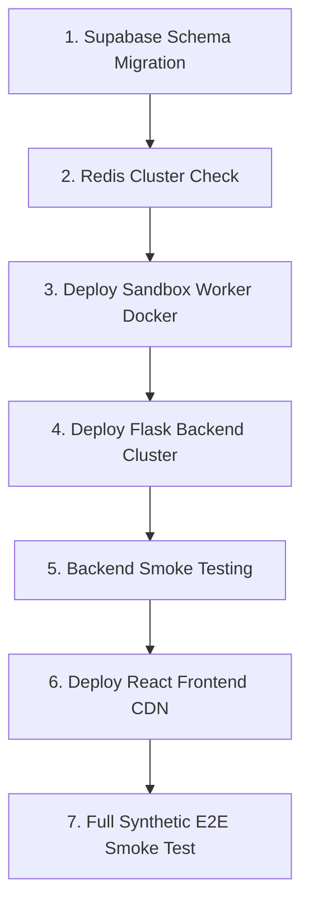

# PrepFly Commercial Launch & Incident Response Runbook

**Document Version:** 1.0.0  
**Effective Date:** November 2, 2026  
**Target Systems:** PrepFly Backend (Flask), Sandbox Worker (FastAPI/Docker), Frontend (React/Vite), Supabase PostgreSQL, Redis Cache, Razorpay Gateway, Gemini AI  
**Author:** Principal DevOps, Cloud Architect & Site Reliability Engineering (SRE) Lead  

---

## 1. PRE-LAUNCH VERIFICATION GATES (T-24h to T-1h)

Before promoting any build to commercial production, execute and sign off on each pre-launch gate:

### 1.1 Infrastructure & DNS Sanity Checks
- [ ] **DNS Records Propagated:** Confirm apex and subdomains (`prepfly.com`, `api.prepfly.com`, `sandbox.internal.prepfly.com`) resolve cleanly with low TTL (300s):
  ```powershell
  Resolve-DnsName -Name api.prepfly.com -Type A
  ```
- [ ] **TLS/SSL Validation:** Ensure certificates are valid and enforce TLS 1.3:
  ```powershell
  curl.exe -Iv https://api.prepfly.com/health
  ```
- [ ] **Backend Configuration Audit:** Ensure production environment file contains NO placeholder values:
  ```bash
  # Ensure no localhost entries exist in production configuration
  grep -rn "localhost" f_backend/.env.production
  # Verify required isolated sandbox pointer
  grep "ISOLATED_SANDBOX_URL" f_backend/.env.production
  ```

### 1.2 Upstream Dependency Status
- [ ] **Supabase PostgreSQL:** Verify database is online, pgbouncer connection pooler active, and `SUPABASE_SERVICE_ROLE_KEY` is operational.
- [ ] **Google Gemini API:** Validate quota allocations in Google Cloud Console (`gemini-1.5-pro` & `gemini-1.5-flash`). Ensure credit billing alerts ($100, $500 thresholds) are active.
- [ ] **Razorpay Live Gateway:** Verify API keys switched from `rzp_test_...` to `rzp_live_...` with webhook endpoint active and `RAZORPAY_WEBHOOK_SECRET` installed.

---

## 2. PRODUCTION DEPLOYMENT SEQUENCE (T-0)

Execute the deployment strictly in the numbered order below to prevent dependency race conditions.



### Step 1: Database Migration
Apply schema updates directly to Supabase using the managed migration pipeline:
```bash
# Verify schema integrity and table presence (organizations, users, interviews, payments)
python f_backend/local_supabase.py --verify-schema
```

### Step 2: Sandbox Worker Deployment (Container Isolation)
Launch the sandboxed code evaluation engine on an isolated network node:
```bash
cd sandbox_worker
docker build -t prepfly-sandbox:production .
docker run -d \
  --name prepfly-sandbox \
  --restart unless-stopped \
  --memory="512m" \
  --cpus="1.0" \
  --pids-limit=64 \
  --read-only \
  --tmpfs /tmp:rw,noexec,nosuid,size=64m \
  -p 8000:8000 \
  prepfly-sandbox:production
```
*Health verification:*
```bash
curl -f http://127.0.0.1:8000/health
```

### Step 3: Flask Backend Deployment (Railway / Ubuntu VPS)
Start backend Gunicorn processes with gevent/gthread workers:
```bash
cd f_backend
# Activate production virtualenv
source venv/bin/activate
# Run pre-flight lint & syntax checks
python -m ruff check app.py services/ tests/ --select F821,E9,F811
# Start Production Gunicorn Daemon
gunicorn --bind 0.0.0.0:5000 \
         --workers 4 \
         --threads 2 \
         --timeout 60 \
         --access-logfile /var/log/prepfly/access.log \
         --error-logfile /var/log/prepfly/error.log \
         app:app
```

### Step 4: React Frontend Deployment (Vercel / Cloudflare Pages)
Build and deploy production bundle with environment variables locked:
```bash
cd f_frontend
npm ci --production=false
npm run build
# Deploy output dist/ directory to edge hosting (e.g. Vercel)
vercel --prod --token $VERCEL_DEPLOY_TOKEN
```

---

## 3. SMOKE-TESTING & HEALTH VERIFICATION COMMANDS

Immediately following deployment, run these non-destructive tests:

### 3.1 Backend & Sandbox Heartbeats
```powershell
# 1. Backend Core Health
curl.exe -i -s https://api.prepfly.com/health
# Expected: HTTP 200 OK, {"status": "ok", "service": "PrepFly Backend"}

# 2. Multi-Tier Cache Verification
curl.exe -i -s https://api.prepfly.com/api/cache/stats
# Expected: HTTP 200 OK, {"status": "healthy", "redis_connected": true, ...}

# 3. Sandbox Worker Connectivity
curl.exe -i -s http://127.0.0.1:8000/health
# Expected: HTTP 200 OK, {"status": "ok", "worker": "sandbox"}
```

### 3.2 Automated Regression Suite Smoke Run
Run the verified 86-test backend test suite against the staging/canary container:
```powershell
.\venv\Scripts\python.exe run_all_tests.py
# Expected: 86 passed, 0 failures, 0 errors
```

---

## 4. ROLLBACK TRIGGERS & PROCEDURES

If any critical threshold is breached during the initial 60 minutes post-launch, trigger an immediate rollback.

### 4.1 Rollback Triggers
| Metric | Threshold | Action |
| :--- | :--- | :--- |
| **5xx HTTP Server Error Rate** | > 2% of total traffic over 3 minutes | Automated Rollback |
| **Razorpay Checkout Webhook Failure** | ≥ 2 consecutive unhandled webhooks | Immediate Rollback to maintenance mode |
| **Gemini AI Generation Latency (p95)** | > 25 seconds sustained | Fallback to cached responses / degraded alert |
| **Code Execution Sandbox Errors** | > 10% 503 Service Unavailable | Rollback backend commit |

### 4.2 Frontend Rollback Procedure (Vercel)
```bash
# Instant Edge Rollback: Point alias back to previous stable deployment ID
vercel alias set dpl_previousStableBuildId prepfly.com
```

### 4.3 Backend Rollback Procedure
```bash
# 1. Rollback git deployment to previous tagged release
git checkout tags/v1.0.0-stable
# 2. Restart backend gunicorn workers smoothly (zero downtime HUP signal)
kill -HUP $(cat /var/run/prepfly-gunicorn.pid)
# 3. Re-verify health
curl -f https://api.prepfly.com/health
```

### 4.4 Database Rollback (Point-in-Time Recovery)
- Do not run manual destructive SQL `DROP TABLE` in production.
- Access the **Supabase Dashboard -> Database -> Backups**.
- Select **Point-in-Time Recovery (PITR)** to restore the snapshot immediately prior to the deployment timestamp.

---

## 5. INCIDENT RESPONSE PROCEDURES (SOP)

### SOP-01: Razorpay Payment Success but Subscription Not Activated
**Symptoms:** Customer bank deducted money, but student account shows "Free Plan" or locked dashboard.  
**Severity:** P0 — Commercial Revenue Critical.  
**Procedure:**
1. Open Razorpay Dashboard -> **Transactions** -> Filter by customer email or phone.
2. Confirm payment status is `captured` and copy `razorpay_payment_id`.
3. Check `f_backend/services/payment_service.py` webhook logs:
   ```bash
   grep -rn "payment.captured" /var/log/prepfly/error.log
   ```
4. If webhook signature was rejected due to timestamp mismatch, manually reconcile:
   - Query `payments` table in Supabase:
     ```sql
     SELECT * FROM payments WHERE razorpay_payment_id = 'pay_xxx';
     ```
   - Update subscription state for user's organization:
     ```sql
     UPDATE organizations 
     SET subscription_plan = 'pro', subscription_status = 'active', 
         subscription_start = NOW(), subscription_end = NOW() + INTERVAL '1 year' 
     WHERE id = (SELECT organization_id FROM users WHERE email = 'customer@domain.com');
     ```
5. Trigger manual notification email to customer apologizing for the latency.

---

### SOP-02: Google Gemini Rate Limit Exhaustion (HTTP 429 Too Many Requests)
**Symptoms:** Mock interview screen shows generic fallback questions or errors like *"AI interview assistant currently unavailable"*.  
**Severity:** P1 — Core AI Feature Degradation.  
**Procedure:**
1. Check Google Cloud Console AI Studio quota dashboard: Verify if RPM (Requests Per Minute) or TPM (Tokens Per Minute) limit reached.
2. Verify Redis Multi-Tier Cache is active (`/api/cache/stats`). If Redis went down, backend will flood Gemini with uncached identical prompt requests.
3. If Redis crashed:
   ```bash
   sudo systemctl restart redis-server
   ```
4. If primary Gemini API key exhausted daily quota, swap to secondary backup project key:
   - In `f_backend/.env`, update `GEMINI_API_KEY_BACKUP`.
   - Reload Flask process: `kill -HUP <PID>`.

---

### SOP-03: Malicious Code Execution / Sandbox Worker Saturation
**Symptoms:** Sandbox response latency exceeds 15 seconds; host CPU approaches 100%.  
**Severity:** P0 — Infrastructure Isolation & Stability.  
**Procedure:**
1. Inspect running sandbox containers:
   ```bash
   docker stats --no-stream
   ```
2. Identify runaway processes inside the container:
   ```bash
   docker top prepfly-sandbox
   ```
3. Terminate and recreate fresh container instance:
   ```bash
   docker kill prepfly-sandbox
   docker rm prepfly-sandbox
   docker run -d --name prepfly-sandbox --restart unless-stopped --memory="512m" --cpus="1.0" --pids-limit=64 --read-only --tmpfs /tmp:rw,noexec,nosuid,size=64m -p 8000:8000 prepfly-sandbox:production
   ```
4. Extract user IP and submitter ID from backend logs and apply temporary IP ban via Cloudflare WAF.

---

### SOP-04: Client ID Spoofing / Unauthorized Object Access Detected
**Symptoms:** Log alert: `User mismatch detected between JWT sub and payload user_id`.  
**Severity:** P0 — Security Vulnerability (Broken Object-Level Authorization).  
**Procedure:**
1. Locate attacking IP and authorization header token:
   ```bash
   grep -rn "Authorization" /var/log/prepfly/access.log | grep "/upload"
   ```
2. Invalidate the user session token immediately by adding user ID to Redis Token Blocklist:
   ```bash
   redis-cli SET "blacklist:token:<jwt_jti>" "revoked" EX 86400
   ```
3. Lock the offending user account in Supabase:
   ```sql
   UPDATE users SET is_active = false WHERE id = '<attacker_user_id>';
   ```

---

## 6. PAYMENT RECONCILIATION PROCEDURES

Execute automated reconciliation nightly at **01:00 UTC**:

```python
# Nightly reconciliation script: f_backend/scripts/reconcile_payments.py
import os
import razorpay
from local_supabase import get_supabase_client

def reconcile():
    client = razorpay.Client(auth=(os.getenv("RAZORPAY_KEY_ID"), os.getenv("RAZORPAY_KEY_SECRET")))
    supabase = get_supabase_client()
    
    # Fetch last 24h payments from Razorpay
    rzp_payments = client.payment.all({"count": 100})
    for p in rzp_payments.get("items", []):
        if p["status"] == "captured":
            # Check Supabase payment record
            res = supabase.table("payments").select("*").eq("razorpay_payment_id", p["id"]).execute()
            if not res.data:
                print(f"[DISCREPANCY] Missing DB record for captured payment: {p['id']}, Amount: {p['amount']}")
                # Log to Sentry & alert finance team
```

---

## 7. FIRST-WEEK POST-LAUNCH MONITORING SCHEDULE

| Day | Primary Focus Area | Metrics & Key Inspection Points |
| :--- | :--- | :--- |
| **Day 1 (Launch Day)** | Traffic Spikes & Gateway | Real-time Sentry error stream; Razorpay webhook conversion rate; 5xx rate |
| **Day 2** | AI Quota & Costs | Daily Gemini API cost per active student; token cache hit ratio (> 40% target) |
| **Day 3** | Sandbox Stability | Execution timeout rates; memory leaks in Docker worker; p95 latency |
| **Day 4** | Database Health | Supabase active connection pool usage (staying below 80% of max limit) |
| **Day 5** | ATS Parsing Success | File upload failure rates; corrupted PDF handling logs; temp file cleanup |
| **Day 6** | Customer Support Audit | Ticket resolution time; user feedback ratings on Ava interview realism |
| **Day 7** | Full Weekly Review | Revenue reconciliation; unit economics validation; P1/P2 backlog grooming |

---

## 8. EMERGENCY CONTACT MATRIX

| Role | Contact Channel | Escalation Trigger |
| :--- | :--- | :--- |
| **Lead DevOps / On-Call SRE** | PagerDuty / SRE Slack Channel | Any 5xx spike > 2% or Sandbox Worker offline |
| **Security Officer** | security@prepfly.com / Emergency Line | Sandbox escape attempt, PII data leak, token exploit |
| **Finance & Billing Lead** | billing@prepfly.com | Razorpay webhook outage, chargeback dispute > 1% |
| **Product & Support Lead** | support@prepfly.com | Customer unable to login or interview generation stalls |
